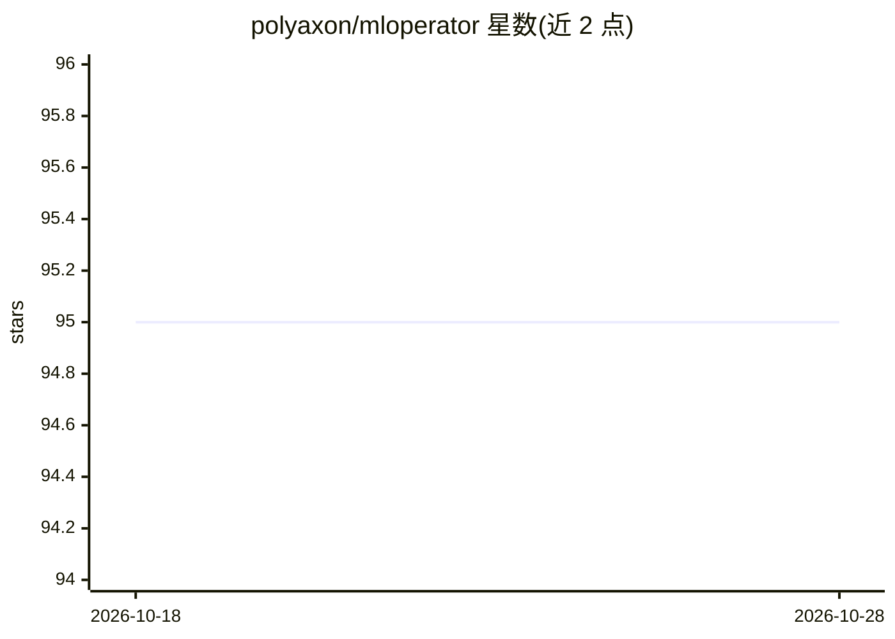

# polyaxon/mloperator

⭐ 95 · Go · Apache-2.0 · 推送 2026-10-19 · [GitHub](https://github.com/polyaxon/mloperator) · [官网](https://polyaxon.com) · 组织维护

**面向 Polyaxon 的 Kubernetes 机器学习运算符与控制器**

一个 Kubernetes 控制器项目，通过自定义资源（CRD）定义并调和 builds、jobs、实验、分布式训练、notebooks、TensorBoard 等运算原语。以 Kubernetes Operator 方式原生扩展 Polyaxon 能力，并原生扩展 Kubeflow Operators（TFJob/PytorchJob/MXNet/XGBoost/MPI/Paddle）、Dask Operator 与 Ray Operator。面向在 Kubernetes 上运行 Polyaxon 工作负载的 MLOps 工程师，Apache 2 许可。

## 筛选速览

| 维度 | 判定 | 备注 |
|---|---|---|
| AI 角色 | `ai-ecosystem` | LLM/agent 周边工具 |
| 许可风险 | `permissive` | Apache-2.0 |
| 部署形态 | `None` |  |
| 模型依赖 | — | README 未给出锁定关系 |
| 硬件要求 | — | 无带数字的原话,不猜 |
| 安装摩擦 | `low` | 无编译、无系统依赖或容器化 |
| 成熟度 | — | 结构信号不足 |

## 能力要点

- 以 Kubernetes Operator/CRD 管理 builds、jobs、实验、分布式训练等原语
- 原生扩展 Kubeflow Operators（TFJob/PytorchJob/MXNet/XGBoost/MPI/Paddle）
- 支持 Dask Operator 与 Ray Operator 集成

## 适用场景

- 在 Kubernetes 上自动化调和 Polyaxon 的训练与实验工作负载
- 复用 Kubeflow、Dask、Ray 的作业算子运行分布式训练
- 统一管理 notebooks、TensorBoard 等 ML 基础设施组件

## 场景标签

`MLOps` · 领域:训练与推理

## 证据(README 行号)

> L16: This project is a Kubernetes controller that manages and watches Customer Resource Definitions (CRDs) that define p
> L22: This Operator extends natively Kubeflow-Operators (TFJob/PytorchJob/MXNet/XGBoost/MPI/Paddle), Dask Operator, Ray O

## 星数曲线

2026-10-18 95 → 2026-10-28 95（+0）

---
*卡片 v1 · prompt 1.4 · 生成 2026-10-23 · 置信度 mid · 依据 README sha `092dea32b5db` · [字段定义](../../DATASET.md)*
