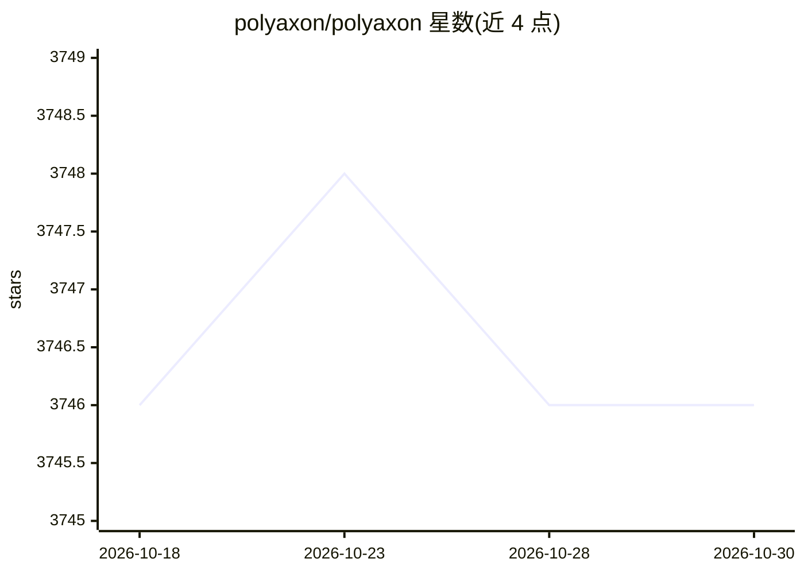

# polyaxon/polyaxon

⭐ 3,746 · MDX · Apache-2.0 · 推送 2026-10-29 · [GitHub](https://github.com/polyaxon/polyaxon) · [官网](https://polyaxon.com) · 组织维护

**深度学习实验平台：可复现、自动化与扩展训练监控**

面向大规模深度学习应用的平台，提供实验训练、日志与资源跟踪、分布式作业、超参数调优、并行执行与基于 DAG 的容器原生流水线。部署于任意数据中心或云服务商，也可由 Polyaxon 托管，将 GPU 服务器转为团队共享自助资源，支持 TensorFlow、PyTorch、MXNet、Caffe 等框架。以 pip 安装 CLI 并通过 Kubernetes 部署，内置仪表盘与 Jupyter/TensorBoard 集成。

## 筛选速览

| 维度 | 判定 | 备注 |
|---|---|---|
| AI 角色 | `ai-ecosystem` | LLM/agent 周边工具 |
| 许可风险 | `permissive` | Apache-2.0 |
| 部署形态 | `library` | 以包/库形式分发 |
| 模型依赖 | — | README 未给出锁定关系 |
| 硬件要求 | — | 无带数字的原话,不猜 |
| 安装摩擦 | `low` | 无编译、无系统依赖或容器化 |
| 成熟度 | — | 结构信号不足 |

## 能力要点

- 分布式训练支持（TensorFlow/PyTorch/MPI/Horovod/Spark/Dask）
- 类似 Google Vizier 的实验组超参数搜索（Grid/Random/Hyperband/贝叶斯等）
- 容器原生 DAG 流水线，操作可为作业、服务、分布式作业或嵌套 DAG
- 内置仪表盘展示项目与实验，可启动 Jupyter notebook 与 TensorBoard

## 适用场景

- 在 Kubernetes 上运行和跟踪大规模深度学习实验
- 组织团队共享 GPU 资源并自助发起训练
- 用实验组自动搜索超参数并管理结果

## 场景标签

`MLOps` · 领域:训练与推理

## 证据(README 行号)

> L18: Welcome to Polyaxon, a platform for building, training, and monitoring large scale deep learning applications.
> L21: Polyaxon deploys into any data center, cloud provider, or can be hosted and managed by Polyaxon, and it supports al
> L23: Polyaxon makes it faster, easier, and more efficient to develop deep learning applications by managing workloads wi

## 星数曲线

2026-10-18 3,746 → 2026-10-30 3,746（+0）

---
*卡片 v1 · prompt 1.4 · 生成 2026-10-21 · 置信度 high · 依据 README sha `8d6c656114eb` · [字段定义](../../DATASET.md)*
