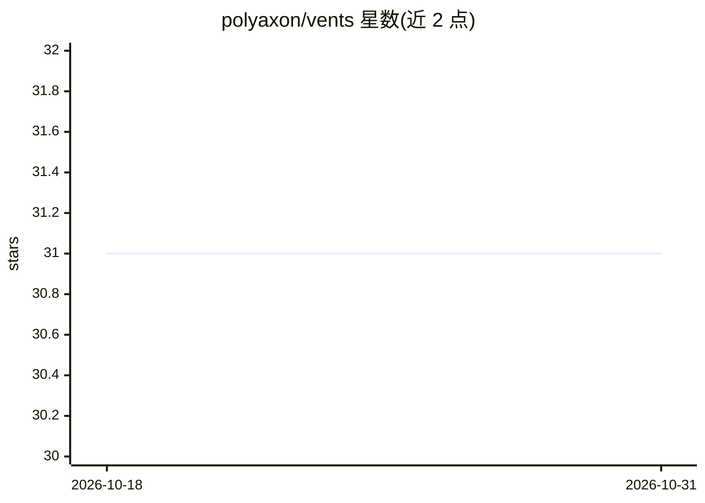

# polyaxon/vents

⭐ 31 · Python · Apache-2.0 · 推送 2026-10-20 · [GitHub](https://github.com/polyaxon/vents) · 组织维护

**开源的连接目录、集成与告警通知库**

Vents 是由 Polyaxon 维护的开源 Python 库，提供连接目录（connections catalog）、第三方集成、工具集成以及告警与通知功能，服务于流水线与可观测性场景。README 仅包含项目简介与安装说明，未提供更多功能细节；可通过 pip 安装。作为 Polyaxon 生态的组件，主要面向构建或运行工作流/流水线的开发者使用。

## 筛选速览

| 维度 | 判定 | 备注 |
|---|---|---|
| AI 角色 | `ai-ecosystem` | LLM/agent 周边工具 |
| 许可风险 | `permissive` | Apache-2.0 |
| 部署形态 | `library` | 以包/库形式分发 |
| 模型依赖 | — | README 未给出锁定关系 |
| 硬件要求 | — | 无带数字的原话,不猜 |
| 安装摩擦 | `low` | 无编译、无系统依赖或容器化 |
| 成熟度 | — | 结构信号不足 |

## 能力要点

- 提供连接目录与集成功能
- 提供告警与通知能力
- 以 Python 库形式提供，pip 安装

## 适用场景

- 在流水线项目中集成连接目录与第三方服务
- 为自动化流程添加告警与通知

## 场景标签

 · 领域:MLOps/自动化基础设施

## 证据(README 行号)

> L6: Open source connections catalog, integrations, alerting, and notifications library.

## 星数曲线

2026-10-18 31 → 2026-10-31 31（+0）

---
*卡片 v1 · prompt 1.4 · 生成 2026-10-26 · 置信度 low · 依据 README sha `429ec29c89a4` · [字段定义](../../DATASET.md)*
