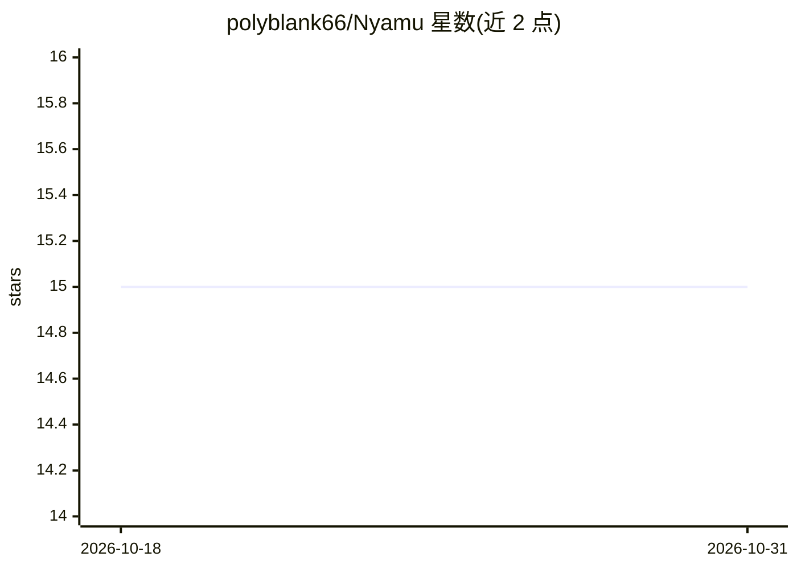

# polyblank66/Nyamu

⭐ 15 · C# · MIT · 推送 2026-08-25 · [GitHub](https://github.com/polyblank66/Nyamu) · 个人维护

**Unity 编辑器 MCP 服务器：让编程 agent 自行检查脚本编译**

面向 Unity 开发者的极简 MCP 服务器，基于 Keijiro 的 Yamu PoC。核心动机是让编码 agent 能自己验证生成代码是否编译通过，支持 Unity 2021.3 及以上（早于 Unity 6 官方 MCP 的项目可用）。提供脚本/着色器编译检查、测试运行、Play Mode 控制、ad-hoc C# 代码执行、编辑器日志读取等工具，通过自动生成的 nyamu.bat 接入 Claude Code、Zed、Rider 等客户端。仅 Windows 经过测试，需 Node.js 运行中间服务器。

## 筛选速览

| 维度 | 判定 | 备注 |
|---|---|---|
| AI 角色 | `ai-ecosystem` | LLM/agent 周边工具 |
| 许可风险 | `permissive` | MIT |
| 部署形态 | `desktop` | 安装包/桌面程序 |
| 模型依赖 | — | README 未给出锁定关系 |
| 硬件要求 | — | 无带数字的原话,不猜 |
| 安装摩擦 | `low` | 无编译、无系统依赖或容器化 |
| 成熟度 | — | 结构信号不足 |

## 能力要点

- scripts_compile 等编译检查工具，兼容 Unity 2021.3+
- tests_run_* 支持 EditMode/PlayMode 测试与正则过滤
- code_execute 可在编辑器内运行临时 C# 代码片段
- 多编辑器实例自动分配独立端口，响应长度可配置截断

## 适用场景

- 让 Claude Code 等 agent 在 Unity 项目中自查编译结果
- 未迁移 Unity 6 的项目接入 MCP 工具链
- agent 自动运行 Unity 测试并读取编辑器日志定位问题

## 场景标签

`编码 Agent` · 领域:编码与开发

## 证据(README 行号)

> L4: **Nyamu** is a minimal MCP server for Unity, designed to give coding agents a way to check script compilation. It is
> L10: Hi! My name is Ivan, and I work as a programmer in gamedev. I started this project in September 2025 out of frustra

## 星数曲线

2026-10-18 15 → 2026-10-31 15（+0）

---
*卡片 v1 · prompt 1.4 · 生成 2026-10-30 · 置信度 mid · 依据 README sha `ad9b4a64e13b` · [字段定义](../../DATASET.md)*
