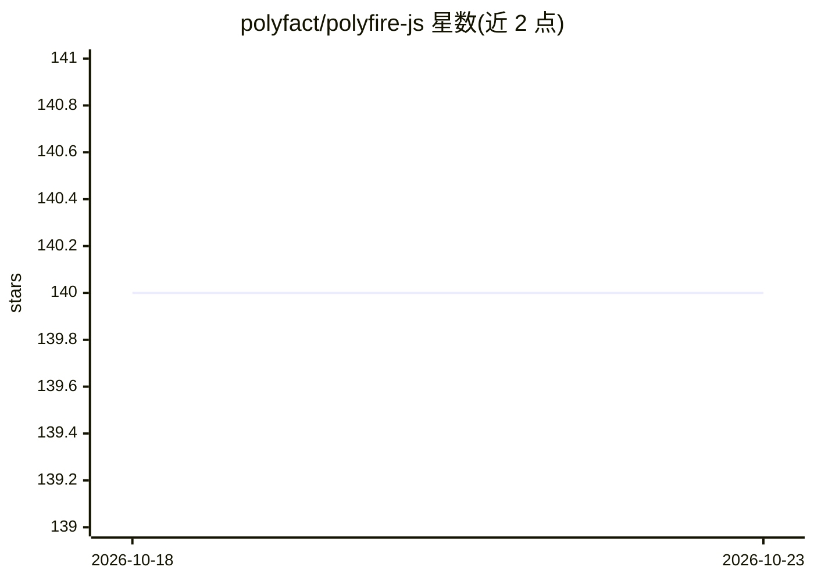

# polyfact/polyfire-js

⭐ 140 · JavaScript · 推送 2026-07-31 · [GitHub](https://github.com/polyfact/polyfire-js) · [官网](https://www.npmjs.com/package/polyfire-js) · 组织维护

**面向 AI 应用的托管后端 JS/React SDK**

Polyfire 的 JavaScript/TypeScript SDK，连接 Polyfire 托管 AI 后端，使开发者从前端直接构建 AI 应用，无需自建后端。提供文本生成、音频转录、Chat 类、记忆（嵌入）管理、图像生成、数据加载器、键值存储、用量追踪与类型校验等功能，并提供 React 组件（TextGenerated、Login）与可经 script 标签引入的浏览器构建。注意：仓库自 2023 年起停止维护，所属开发者工具产品已停运。

## 筛选速览

| 维度 | 判定 | 备注 |
|---|---|---|
| AI 角色 | `ai-ecosystem` | LLM/agent 周边工具 |
| 许可风险 | `none` | — |
| 部署形态 | `library` | 以包/库形式分发 |
| 模型依赖 | — | README 未给出锁定关系 |
| 硬件要求 | — | 无带数字的原话,不猜 |
| 安装摩擦 | `low` | 无编译、无系统依赖或容器化 |
| 成熟度 | — | 结构信号不足 |

## 能力要点

- 文本生成、转录、图像生成等前端可调用能力
- 记忆（嵌入）管理与数据加载器
- React 组件（TextGenerated、Login）与浏览器 script 引入方式
- 键值存储与用量追踪

## 适用场景

- 在前端直接调用文本生成/转录/图像生成能力
- 为 AI 应用省去自建后端
- 在 React 项目中快速集成登录与生成组件

## 场景标签

`图像生成` · 领域:内容生成

## 证据(README 行号)

> L7:  ⚡ An all-in-one managed backend for AI apps. Build AI apps from the frontend, very fast. 🪶
> L55: This SDK provides functionalities for text generation, transcription, memory management, image generation, and data

## 星数曲线

2026-10-18 140 → 2026-10-23 140（+0）

---
*卡片 v1 · prompt 1.4 · 生成 2026-10-22 · 置信度 high · 依据 README sha `2fd12452a500` · [字段定义](../../DATASET.md)*
