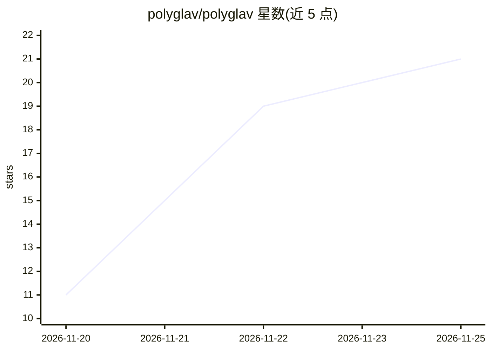

# polyglav/polyglav

⭐ 21 · Python · MIT · 推送 2026-11-14 · [GitHub](https://github.com/polyglav/polyglav) · [官网](https://polyglav.github.io/polyglav/) · 个人维护

**终端里的多智能体任务编排 AI 助手**

运行于终端的 AI agent 工具：用户描述一个目标后，它拆解为多个步骤，调用专职 agent 按顺序接力完成，全程单一提示交互。支持读写文件、网页搜索、执行命令、编辑代码、提交版本，所有工具均受权限控制；HTTP API 需令牌。零依赖（纯 Python 标准库），配置与会话日志保留本地，可用自带 API key 或全本地运行。通过 pipx 安装，提供 REPL、无头 CLI、HTTP API、Docker 与插件机制。

## 筛选速览

| 维度 | 判定 | 备注 |
|---|---|---|
| AI 角色 | `ai-native` | 本体是模型或模型工具 |
| 许可风险 | `permissive` | MIT |
| 部署形态 | `library` | 以包/库形式分发 |
| 模型依赖 | local-ok | 支持本地模型 |
| 硬件要求 | — | 无带数字的原话,不猜 |
| 安装摩擦 | `low` | 无编译、无系统依赖或容器化 |
| 成熟度 | — | 结构信号不足 |

## 能力要点

- 任务拆解后由专职 agent 按序接力执行，共享结果上下文
- 文件读写、网页搜索、命令执行等工具均受权限控制
- 零依赖：纯 Python 标准库实现
- 支持 Ollama、OpenAI、Groq、Anthropic 及 OpenAI 兼容端点

## 适用场景

- 让规划-编码-评审多角色 agent 顺序完成一个功能开发
- 用 cron 定时调度 agent 更新文档或汇总日志
- 通过 HTTP API 在脚本或 CI 中驱动同一 agent 循环
- 本地运行、密钥与日志不出本机的自动化任务

## 场景标签

`多智能体` `AI 助手` · 领域:Agent 开发

## 证据(README 行号)

> L14: Polyglav is an AI agent that lives in your terminal. You describe an outcome once, it breaks the job into steps, br
> L25: - **Many providers, any model** - Ollama, OpenAI, Groq, Anthropic, OpenCode, or any OpenAI-compatible endpoint, pic

## 星数曲线

2026-11-20 11 → 2026-11-25 21（+10）

---
*卡片 v1 · prompt 1.4 · 生成 2026-11-20 · 置信度 high · 依据 README sha `82bf77d0682a` · [字段定义](../../DATASET.md)*
