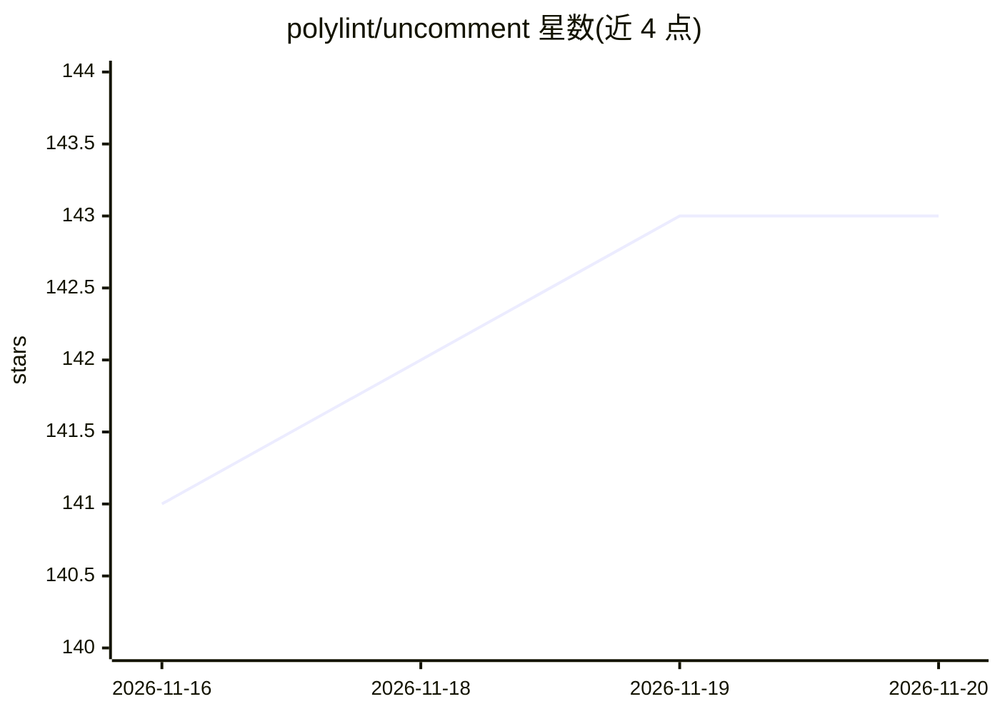

# polylint/uncomment

⭐ 143 · Rust · MIT · 推送 2026-11-16 · [GitHub](https://github.com/polylint/uncomment) · [官网](https://github.com/polylint/uncomment#readme) · 组织维护

**基于 tree-sitter 的注释删除与标签注释检查工具**

面向开发者的代码注释处理工具，包含两项功能：删除注释与检查标签注释。基于 tree-sitter AST 解析，支持 306 种语言，默认保留 TODO/FIXME、文档注释与 lint 指令；lint 子命令检查 TODO/FIXME/HACK/XXX 是否携带真实 issue key。支持整树、分支变更或逐行范围的门禁模式，提供 dry-run 预览。通过 Homebrew/Scoop/Cargo/npm/pip 安装，可作 Rust 库使用并接受宿主已持有的 tree-sitter 树。项目最初为清理 AI 生成代码中的解释性注释而构建，并提供 agent 插件接入。

## 筛选速览

| 维度 | 判定 | 备注 |
|---|---|---|
| AI 角色 | `ai-enhanced` | 去掉 AI 部分产品仍成立 |
| 许可风险 | `permissive` | MIT |
| 部署形态 | `self-host` | docker 或自建部署 |
| 模型依赖 | — | README 未给出锁定关系 |
| 硬件要求 | — | 无带数字的原话,不猜 |
| 安装摩擦 | `low` | 无编译、无系统依赖或容器化 |
| 成熟度 | — | 结构信号不足 |

## 能力要点

- tree-sitter AST 解析，支持 306 种语言（55 种内置配置）
- 标签注释 lint：检查 TODO/FIXME/HACK/XXX 是否携带真实 issue key
- 门禁模式支持整树、--changed-only/--changed-lines、--staged 范围
- 可作 Rust 库使用，宿主可传入已有 tree-sitter 树做增量解析

## 适用场景

- 清理代码库中的冗余注释，尤其是 AI 生成代码的解释性注释
- 在提交或 PR 门禁中检查标签注释是否指向有效 issue
- 接入 agent 工具链按需执行注释清理

## 场景标签

 · 领域:开发者工具/代码质量

## 证据(README 行号)

> L29: Originally built to clean up AI-generated code drowning in explanatory comments, it now works on
> L5: uncomment is a comment remover and a comment linter, both built on tree-sitter's AST — so both are

## 星数曲线

2026-11-16 141 → 2026-11-20 143（+2）

---
*卡片 v1 · prompt 1.4 · 生成 2026-11-17 · 置信度 low · 依据 README sha `1fc54f12936f` · [字段定义](../../DATASET.md)*
