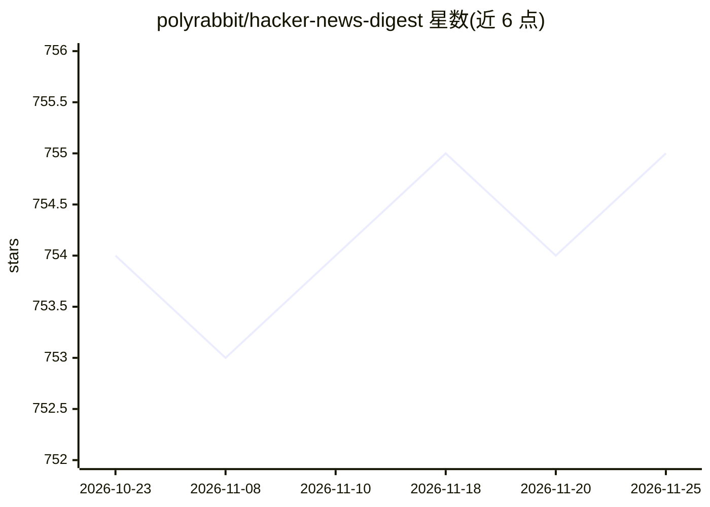

# polyrabbit/hacker-news-digest

⭐ 755 · Python · LGPL-3.0 · 推送 2026-11-23 · [GitHub](https://github.com/polyrabbit/hacker-news-digest) · [官网](http://hackernews.betacat.io/) · 个人维护

**为 Hacker News 首页新闻自动生成 AI 摘要与配图的静态站**

通过 GitHub Actions 定时抓取 Hacker News 首页文章，用评分算法抽取正文，调用 OpenAI API 生成短摘要（无 API 时回退到本地 Qwen 模型），并自动挑选配图、内嵌视频与 GitHub gist，渲染为托管在 GitHub Pages 的静态站点。支持按 points/评论数/时间排序与 top N 过滤、每日存档、RSS 订阅，翻译亦由 LLM 完成（当前支持中文）。摘要所用模型会在页面中标注。

## 筛选速览

| 维度 | 判定 | 备注 |
|---|---|---|
| AI 角色 | `ai-native` | 本体是模型或模型工具 |
| 许可风险 | `viral` | LGPL-3.0 |
| 部署形态 | `None` |  |
| 模型依赖 | — | README 未给出锁定关系 |
| 硬件要求 | — | 无带数字的原话,不猜 |
| 安装摩擦 | `low` | 无编译、无系统依赖或容器化 |
| 成熟度 | — | 结构信号不足 |

## 能力要点

- 远程 LLM 生成摘要，本地 Qwen 作为回退
- GitHub Actions 定时流水线：抓取→正文抽取→配图→摘要→部署
- 每日存档与 RSS 订阅
- LLM 驱动的中文翻译

## 适用场景

- 快速浏览 Hacker News 首页值得读的内容
- 通过 RSS 订阅每日新闻摘要
- 阅读新闻的中文翻译版本

## 场景标签

`AI 写作` · 领域:内容生成

## 证据(README 行号)

> L10: Hacker News Summary adds short AI summaries and images to stories
> L39: Hacker News Summary is a static site hosted on GitHub Pages. A GitHub Actions workflow periodically performs the fo
> L45: 4. Generating summaries of the article's content using OpenAI API, or falling back to a local model.

## 星数曲线

2026-10-23 754 → 2026-11-25 755（+1）

---
*卡片 v1 · prompt 1.4 · 生成 2026-11-25 · 置信度 high · 依据 README sha `0eda3aabaefb` · [字段定义](../../DATASET.md)*
