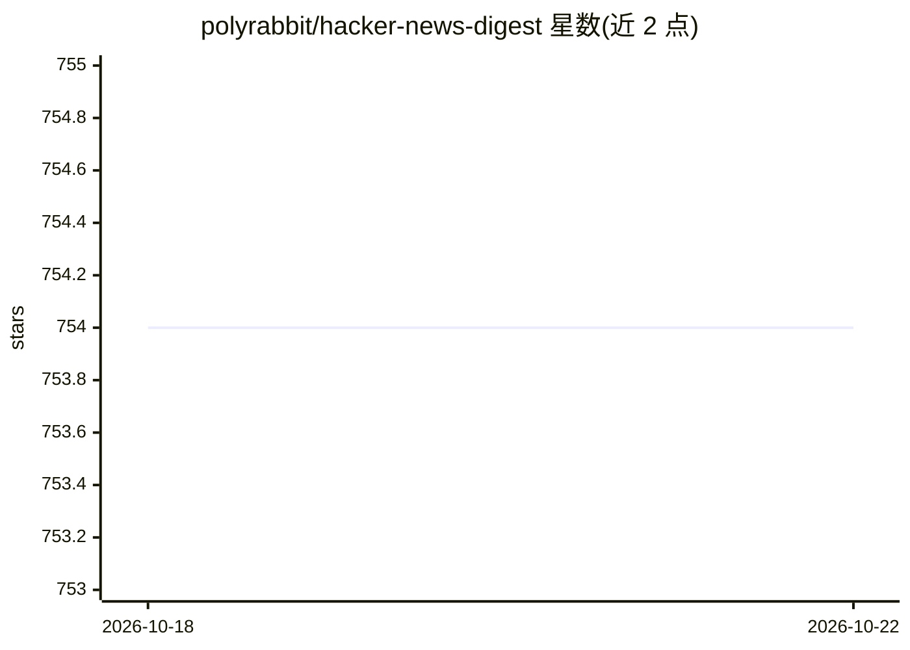

# polyrabbit/hacker-news-digest

⭐ 754 · Python · LGPL-3.0 · 推送 2026-10-08 · [GitHub](https://github.com/polyrabbit/hacker-news-digest) · [官网](http://hackernews.betacat.io/) · 个人维护 · 中文 README

**用 LLM 为 Hacker News 文章生成摘要与配图的静态站点**

部署在 GitHub Pages 上的静态站点：周期性抓取 Hacker News 页面获取文章列表，用评分算法抽取正文，为每篇文章选取插图并生成本地副本，摘要主要由远程 LLM 服务（OpenAI API）生成，远程不可用时回退到本地 Qwen 模型；还通过 prompt 附加步骤完成中文翻译，支持按分数/评论数/时间排序、按分数筛选 topN 与 RSS 输出，可嵌入视频站、PDF 和 GitHub gist。面向想快速浏览 Hacker News 的读者。

## 筛选速览

| 维度 | 判定 | 备注 |
|---|---|---|
| AI 角色 | `ai-native` | 本体是模型或模型工具 |
| 许可风险 | `viral` | LGPL-3.0 |
| 部署形态 | `None` |  |
| 模型依赖 | — | README 未给出锁定关系 |
| 硬件要求 | — | 无带数字的原话,不猜 |
| 安装摩擦 | `low` | 无编译、无系统依赖或容器化 |
| 成熟度 | — | 结构信号不足 |

## 能力要点

- 远程 LLM 生成摘要，不可用时回退本地 Qwen 模型
- 正文评分抽取 + 自动选图并本地化存储
- 支持按分数/评论数/时间排序与 topN 过滤
- RSS 全支持与 LLM 中文翻译

## 适用场景

- 快速浏览 Hacker News 头条并获得中文摘要
- 通过 RSS 订阅 AI 摘要版 Hacker News
- 按分数筛选只看高分文章

## 场景标签

`网页抓取` `AI 写作` · 领域:效率与自动化

## 证据(README 行号)

> L14: Summaries are primarily generated by a remote LLM service, with local Qwen as fallback when remote inference is una
> L48: 4. Generating summaries of the article's content using OpenAI API or invoking a local model as a

## 星数曲线

2026-10-18 754 → 2026-10-22 754（+0）

---
*卡片 v1 · prompt 1.4 · 生成 2026-10-21 · 置信度 high · 依据 README sha `1d03631e5b49` · [字段定义](../../DATASET.md)*
