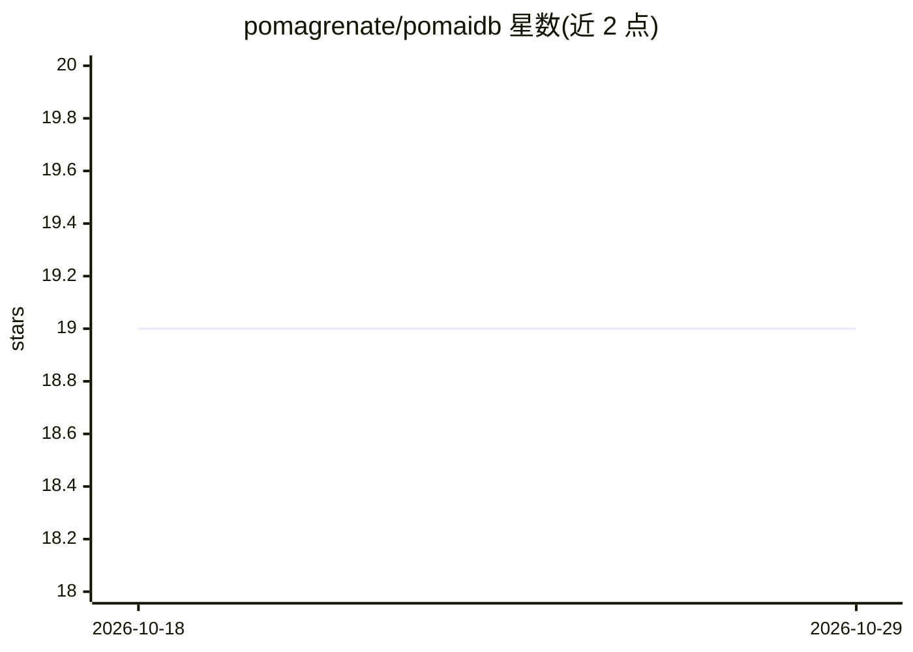

# pomagrenate/pomaidb

⭐ 19 · C++ · Apache-2.0 · 推送 2026-10-09 · [GitHub](https://github.com/pomagrenate/pomaidb) · [官网](https://pomaidb-web.vercel.app) · 个人维护

**面向边缘设备的嵌入式多模态向量数据库与离线 RAG 引擎**

C++20 编写的嵌入式向量数据库，供资源受限的边缘设备（树莓派、Orange Pi、Jetson、NAS、网关、摄像头）在应用进程内直接运行。提供向量检索（IVF/HNSW、SQ8 量化）、全离线 RAG 流水线（可接入 GGML/llama.cpp 小型本地嵌入模型）、图/时序/键值/网格等多模态存储与混合检索。设计约束为单线程事件循环、仅追加日志结构存储、有界内存（可运行于约 64–128 MB RAM 配置）、AES-256-GCM 静态加密。提供 C++ 与 Python API，附企业边缘基准测试套件。

## 筛选速览

| 维度 | 判定 | 备注 |
|---|---|---|
| AI 角色 | `ai-ecosystem` | LLM/agent 周边工具 |
| 许可风险 | `permissive` | Apache-2.0 |
| 部署形态 | `None` |  |
| 模型依赖 | — | README 未给出锁定关系 |
| 硬件要求 | — | 无带数字的原话,不猜 |
| 安装摩擦 | `high` | 编译与系统依赖俱全 |
| 成熟度 | — | 结构信号不足 |

## 能力要点

- 嵌入式向量检索：IVF/HNSW、批量搜索、SQ8 标量量化、元数据过滤
- 完全离线的设备端 RAG 流水线（EmbeddingProvider、零拷贝分块）
- 单线程事件循环 + 仅追加日志存储，面向消费级闪存寿命设计
- 多模态 membrane 架构：向量/图/时序/键值/网格等 13 类数据共库并存

## 适用场景

- 在树莓派/Jetson 等边缘设备上离线运行语义检索与 RAG
- IoT 网关或摄像头设备内的本地 AI 记忆层，无需外部数据库
- 在低内存设备上构建向量+图+时序混合存储的单进程应用

## 场景标签

`向量数据库` `RAG` `语义搜索` · 领域:知识与检索

## 证据(README 行号)

> L23: **PomaiDB is a lightweight, embeddable vector database and multimodal AI memory engine built for edge devices.**
> L25: It brings **vector search, semantic retrieval, offline RAG, graph relationships, mesh data, time-series data, key-v
> L99: PomaiDB includes an embedded RAG pipeline designed to operate entirely on-device.

## 星数曲线

2026-10-18 19 → 2026-10-29 19（+0）

---
*卡片 v1 · prompt 1.4 · 生成 2026-10-28 · 置信度 high · 依据 README sha `c8bb5f01d7f8` · [字段定义](../../DATASET.md)*
