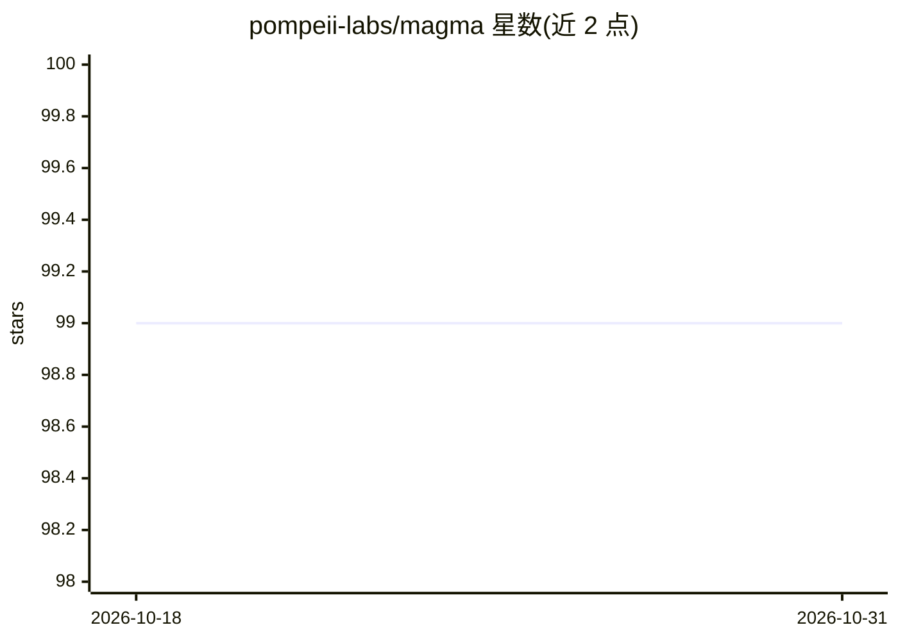

# pompeii-labs/magma

⭐ 99 · TypeScript · 推送 2026-08-03 · [GitHub](https://github.com/pompeii-labs/magma) · [官网](https://magmadeploy.com) · 组织维护

**TypeScript AI agent 框架：用类与装饰器构建可部署的对话代理**

面向开发者的 TypeScript AI agent 框架：以 class 继承 MagmaAgent 定义代理，通过 @tool/@toolparam 添加工具、装饰器添加中间件（LLM 调用前后与工具执行前后四类钩子）、cron 语法定时 Job、@hook 将方法暴露为 API 端点，并内置状态管理与生命周期事件处理。支持多 provider（OpenAI/Anthropic/Groq），切换 provider 无需改动工具或中间件。提供 MagmaDeploy 托管部署或自托管，npm 安装。

## 筛选速览

| 维度 | 判定 | 备注 |
|---|---|---|
| AI 角色 | `ai-ecosystem` | LLM/agent 周边工具 |
| 许可风险 | `none` | — |
| 部署形态 | `library` | 以包/库形式分发 |
| 模型依赖 | locked-api |  |
| 硬件要求 | — | 无带数字的原话,不猜 |
| 安装摩擦 | `low` | 无编译、无系统依赖或容器化 |
| 成熟度 | — | 结构信号不足 |

## 能力要点

- 装饰器式的工具/中间件/定时任务/API 钩子定义
- 四类中间件钩子覆盖 LLM 调用与工具执行前后
- provider 可切换（OpenAI/Anthropic/Groq）且无需改动其余代码
- @hook 可将代理方法暴露为 API 端点

## 适用场景

- 用 TypeScript 快速搭建带工具调用能力的对话代理
- 将代理发布为 API 端点供应用集成
- 通过中间件为代理添加日志、校验或数据清理逻辑

## 场景标签

`Agent 框架` · 领域:Agent 开发

## 证据(README 行号)

> L12: Magma is a framework that lets you create AI agents without the headache. No complex chains, no confusing abstracti
> L34: - **Flexible**: Use any AI provider (OpenAI, Anthropic, Groq)

## 星数曲线

2026-10-18 99 → 2026-10-31 99（+0）

---
*卡片 v1 · prompt 1.4 · 生成 2026-10-23 · 置信度 high · 依据 README sha `af6e9a7c4e4c` · [字段定义](../../DATASET.md)*
