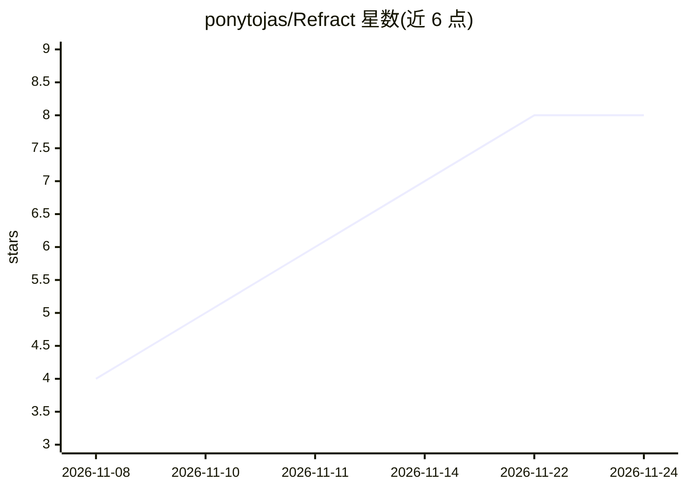

# ponytojas/Refract

⭐ 8 · Go · MIT · 推送 2026-11-23 · [GitHub](https://github.com/ponytojas/Refract) · 个人维护

**自托管 LaTeX 工作区，AI 助手以 diff 形式提议修改**

在自有服务器上运行的 LaTeX 工作区，集成编辑器、Tectonic 编译与 SyncTeX 双向 PDF 预览。AI 部分包括：可读写文件、编译项目、搜索文献的 agent（在独立 git worktree 中工作）、选中文本的快捷改写动作，以及基于 OpenAlex/arXiv 元数据的引文查找——参考文献条目从出版方记录生成而非由模型撰写。所有 AI 修改以 diff 审阅形式呈现，逐文件接受或拒绝。每个项目为 git 仓库。最初作为 OpenAI Prism 的替代品，可打开 Prism 导出文件。

## 筛选速览

| 维度 | 判定 | 备注 |
|---|---|---|
| AI 角色 | `ai-enhanced` | 去掉 AI 部分产品仍成立 |
| 许可风险 | `permissive` | MIT |
| 部署形态 | `desktop` | 安装包/桌面程序 |
| 模型依赖 | local-ok | 支持本地模型 |
| 硬件要求 | — | 无带数字的原话,不猜 |
| 安装摩擦 | `low` | 无编译、无系统依赖或容器化 |
| 成熟度 | — | 结构信号不足 |

## 能力要点

- AI agent 在独立 git worktree 工作，修改以 diff 形式逐文件审阅
- 引文检索 OpenAlex 与 arXiv，BibTeX 条目由 doi.org/arXiv 元数据生成
- Tectonic 编译无需安装 TeX 发行版，错误列表带 Fix with AI
- 支持 ChatGPT 计划、自有 API key（OpenAI/Anthropic/Gemini/OpenRouter）或 Ollama 本地模型

## 适用场景

- 在自托管环境撰写 LaTeX 论文并保持 git 版本历史
- 让 AI 修改文档但逐文件审阅后再合并
- 按段落查找真实文献并生成 BibTeX 引用

## 场景标签

`科研工具` `AI 写作` · 领域:内容生成

## 证据(README 行号)

> L3: A self-hosted LaTeX workspace with an AI assistant that proposes changes you review as diffs.
> L31: - **Use the AI you already pay for.** Your ChatGPT plan, your own API keys (OpenAI, Anthropic, Gemini, OpenRouter a

## 星数曲线

2026-11-08 4 → 2026-11-24 8（+4）

---
*卡片 v1 · prompt 1.4 · 生成 2026-11-20 · 置信度 high · 依据 README sha `019310d4545d` · [字段定义](../../DATASET.md)*
