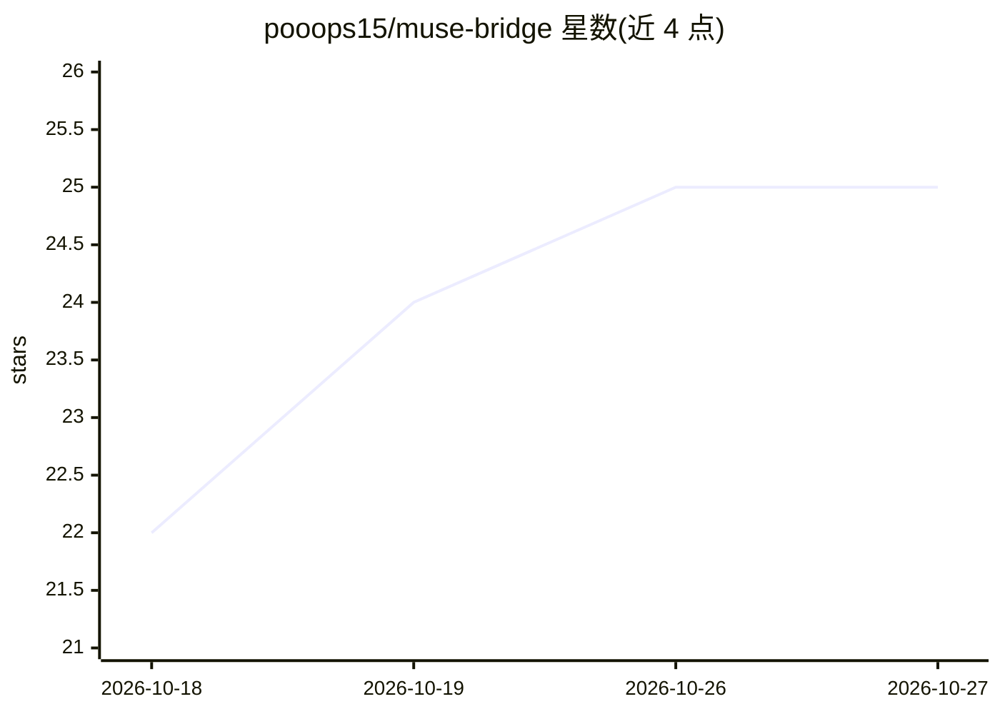

# pooops15/muse-bridge

⭐ 25 · Python · MIT · 推送 2026-10-07 · [GitHub](https://github.com/pooops15/muse-bridge) · 个人维护

**把 Muse agent 桥接成 9Router 内 OpenAI 兼容模型的文件队列桥**

面向自建 VPS 用户的桥接程序：把无 API 的 Muse agent 包装为 9Router 中名为 ms/muse 的模型，供 Hermes 像调用普通 API 模型一样使用。机制为文件队列桥——请求写入 pending 文件夹，Muse 侧 courier 脚本经 SSH 长轮询取单并唤醒 worker，回答写回后经 9Router 返回 Hermes；支持原生 tool calls、图像理解、并行 worker 与用量估算。每轮约 20-30 秒，非实时 API 速度；要求已有 9Router+Hermes 的 VPS 及支持 hooks 的 Muse 环境。提供 Linux/macOS/Windows 自动安装脚本与中英印尼语（英/印尼）教程。

## 筛选速览

| 维度 | 判定 | 备注 |
|---|---|---|
| AI 角色 | `ai-ecosystem` | LLM/agent 周边工具 |
| 许可风险 | `permissive` | MIT |
| 部署形态 | `None` |  |
| 模型依赖 | — | README 未给出锁定关系 |
| 硬件要求 | — | 无带数字的原话,不猜 |
| 安装摩擦 | `low` | 无编译、无系统依赖或容器化 |
| 成熟度 | — | 结构信号不足 |

## 能力要点

- 文件队列桥：Muse 无 API 也可作为 9Router 模型被调用
- 支持原生 tool calls、图像理解与并行 worker（一人一单）
- SSH 长轮询 courier，约 1 秒内发现新请求，空轮询不耗 token
- 提供 Linux/macOS/Windows 自动安装脚本与分步教程

## 适用场景

- 让 Telegram 上的 Hermes 使用 Muse agent 作为模型
- 通过 tool calls 让 Muse 实际检查/操作自己的 VPS
- 在不开新端口的前提下把外部 agent 接入自建模型路由

## 场景标签

`模型网关` · 领域:Agent 开发

## 证据(README 行号)

> L13: **Turn Muse (an AI agent) into a model inside 9Router, so Hermes can use
> L95: |**Bridge**|The small go-between program. In this project: receives requests and stores them as queue files|

## 星数曲线

2026-10-18 22 → 2026-10-27 25（+3）

---
*卡片 v1 · prompt 1.4 · 生成 2026-10-26 · 置信度 high · 依据 README sha `c802392a7458` · [字段定义](../../DATASET.md)*
