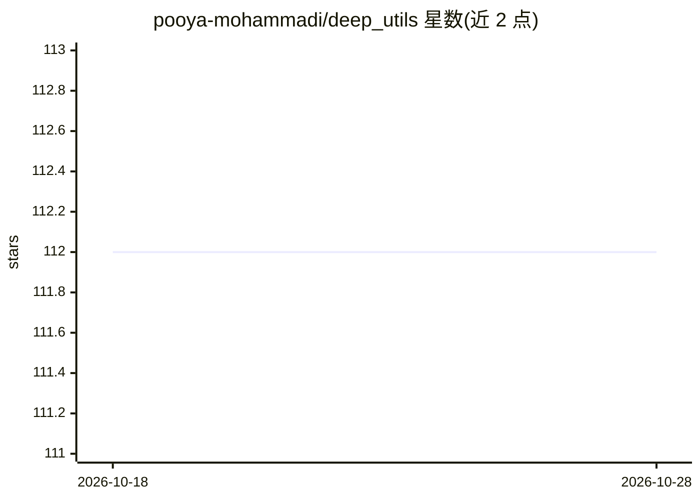

# pooya-mohammadi/deep_utils

⭐ 112 · Python · MIT · 推送 2026-08-20 · [GitHub](https://github.com/pooya-mohammadi/deep_utils) · [官网](https://github.com/pooya-mohammadi/deep_utils) · 组织维护

**面向深度学习从业者的模型与工具函数工具箱**

Python 库 deep-utils，聚合常用深度学习模型为统一接口：人脸检测（MTCNN 等）、目标检测（封装 YOLOv5）、视觉定位（Grounding DINO）、图像编辑（GLIDE）、CutMix 数据增强、多标签分层切分等；模型输出统一为标准 numpy，支持单条与批量预测，另有 DictNamedTuple 等通用工具。安装提供最小版与 cv/tf/torch/torchvision 等变体。README 声明项目仍在密集开发中，功能可能变动；Python 3.8/3.9 已测试，GPU 模型由作者手动测试。

## 筛选速览

| 维度 | 判定 | 备注 |
|---|---|---|
| AI 角色 | `ai-native` | 本体是模型或模型工具 |
| 许可风险 | `permissive` | MIT |
| 部署形态 | `library` | 以包/库形式分发 |
| 模型依赖 | — | README 未给出锁定关系 |
| 硬件要求 | — | 无带数字的原话,不猜 |
| 安装摩擦 | `low` | 无编译、无系统依赖或容器化 |
| 成熟度 | `idea` | |

## 能力要点

- 人脸检测/目标检测/视觉定位/图像编辑模型的统一封装接口
- 模型输出统一为标准 numpy，单条与批量预测均可
- CutMix 增强支持分割与分类任务及批处理
- 多标签分层 train/test 切分函数（stratify_train_test_split_multi_label）

## 适用场景

- 在项目中快速调用 MTCNN/YOLOv5 等模型完成检测任务
- 为分割或分类任务做 CutMix 数据增强
- 对多标签数据集（如目标检测标注）做保持比例的训练/测试切分

## 场景标签

`目标检测` `人脸识别` `图像视频处理` · 领域:感知与多模态

## 证据(README 行号)

> L21: functionalities of famous deep learning models such as MTCNN in face detection, yolov5 in object detection, and man
> L61: We support two subsets of models in Computer Vision.
> L63: * Face Detection

## 星数曲线

2026-10-18 112 → 2026-10-28 112（+0）

---
*卡片 v1 · prompt 1.4 · 生成 2026-10-23 · 置信度 high · 依据 README sha `dc656732593a` · [字段定义](../../DATASET.md)*
