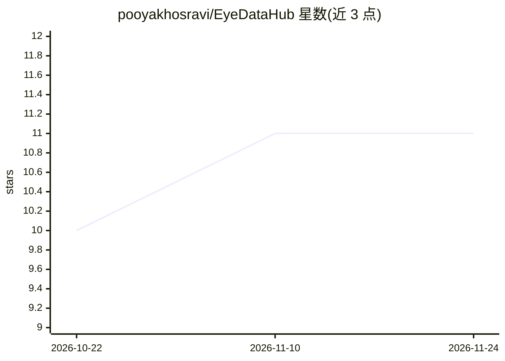

# pooyakhosravi/EyeDataHub

⭐ 11 · Python · NOASSERTION · 推送 2026-09-11 · [GitHub](https://github.com/pooyakhosravi/EyeDataHub) · [官网](http://khosravipooya.com/EyeDataHub/) · 个人维护

**眼科数据集目录 CLI：检索、检视、引用与获取 450+ 官方数据集**

基于人工整理的眼科数据集快照的命令行工具，支持搜索、检视、引用、预检与获取操作，数据来自官方渠道（Dryad、Kaggle、Synapse 等平台 API 或源站链接）。工具不托管也不转载第三方数据集，不代替用户接受来源条款或判断法律许可；获取前展示来源原始条款、认证要求与警告，阻止人工授权路径并在传输成功后写入来源清单。代码 MIT 许可，目录元数据 CC BY 4.0。

## 筛选速览

| 维度 | 判定 | 备注 |
|---|---|---|
| AI 角色 | `ai-knowledge` | 知识聚合/清单类 |
| 许可风险 | `permissive` | NOASSERTION |
| 部署形态 | `library` | 以包/库形式分发 |
| 模型依赖 | — | README 未给出锁定关系 |
| 硬件要求 | — | 无带数字的原话,不猜 |
| 安装摩擦 | `low` | 无编译、无系统依赖或容器化 |
| 成熟度 | — | 结构信号不足 |

## 能力要点

- 451 条人工核验记录，覆盖 18 个主类别、446 个数据集族
- 获取前展示来源条款、认证要求与 route-verification 日期
- 只读工作流（search/show/cite/MCP server），仅显式非 dry-run 的 download 可启动传输
- 提供 hub/catalog.json 与 catalog.csv 机器可读导出

## 适用场景

- 为眼科机器学习研究查找可用数据集及其获取路径
- 按模态、任务、许可条款过滤数据集
- 生成数据集引用与获取来源清单

## 场景标签

`科研工具` · 领域:学习与行业

## 证据(README 行号)

> L3: EyeDataHub is a versioned, community-extensible, source-terms- and access-aware
> L4: command-line tool backed by a manually curated ophthalmology dataset snapshot.
> L25: Release 0.7.0 contains 451 manually source-checked records across

## 星数曲线

2026-10-22 10 → 2026-11-24 11（+1）

---
*卡片 v1 · prompt 1.4 · 生成 2026-11-18 · 置信度 high · 依据 README sha `87d72a52764c` · [字段定义](../../DATASET.md)*
