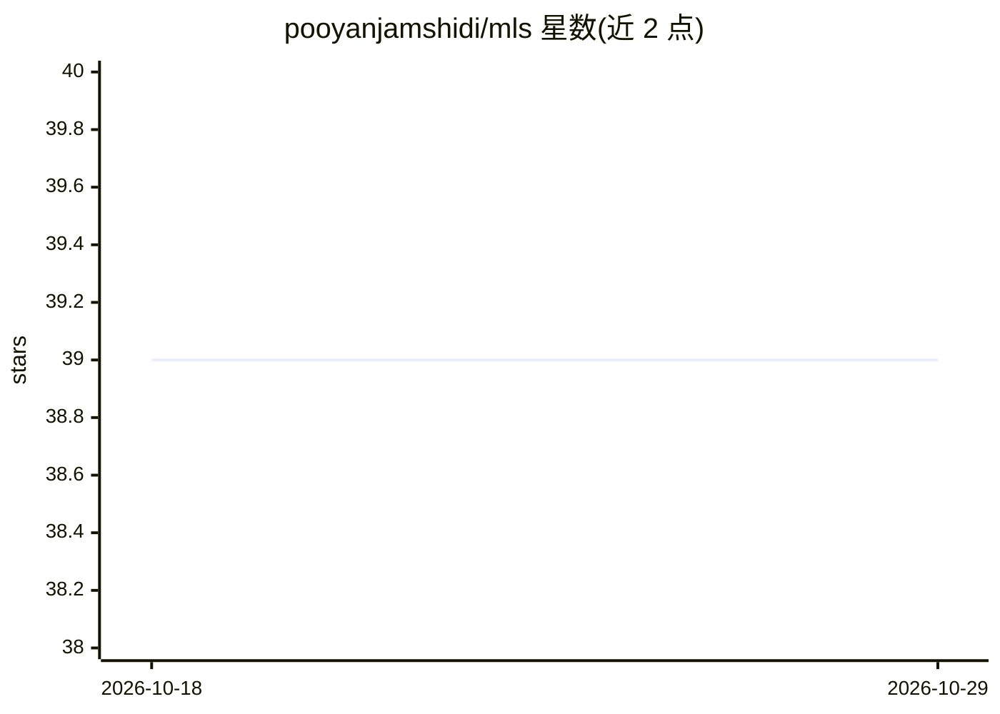

# pooyanjamshidi/mls

⭐ 39 · TeX · MIT · 推送 2026-10-26 · [GitHub](https://github.com/pooyanjamshidi/mls) · 组织维护

**机器学习系统课程讲义与配套资料（USC CSCE 585）**

USC 本科/研究生课程 CSCE 585（Machine Learning Systems）的课程笔记与配套教学资料仓库。内容围绕 ML 作为算法技术与作为生产系统的差异展开，覆盖 ML 系统的构建、测试、部署、交付与演进，讲授保持系统响应性、弹性与容错的策略，以及生产环境中的性能、内存泄漏、通信与多 GPU 等问题。课程以深度学习系统为主要聚焦。仓库注明课程模板来源为 Steven V. Miller。

## 筛选速览

| 维度 | 判定 | 备注 |
|---|---|---|
| AI 角色 | `ai-knowledge` | 知识聚合/清单类 |
| 许可风险 | `permissive` | MIT |
| 部署形态 | `None` |  |
| 模型依赖 | — | README 未给出锁定关系 |
| 硬件要求 | — | 无带数字的原话,不猜 |
| 安装摩擦 | `low` | 无编译、无系统依赖或容器化 |
| 成熟度 | — | 结构信号不足 |

## 能力要点

- 课程笔记与配套教学资料
- 覆盖 ML 系统构建/测试/部署/演进全流程
- 聚焦深度学习系统的生产化问题（性能/内存/多 GPU）

## 适用场景

- 学习 ML 系统生产化的课程内容
- 查阅响应性、弹性与容错等系统设计策略

## 场景标签

`教程课程` · 领域:学习与行业

## 证据(README 行号)

> L3: This repository contains my course notes and other supporting material for CSCE 585, a undergrad/graduate-level clas
> L5: When we talk about Machine Learning (ML), we typically refer to a technique or an algorithm that gives the computer 

## 星数曲线

2026-10-18 39 → 2026-10-29 39（+0）

---
*卡片 v1 · prompt 1.4 · 生成 2026-10-25 · 置信度 high · 依据 README sha `f1b8afd0360b` · [字段定义](../../DATASET.md)*
