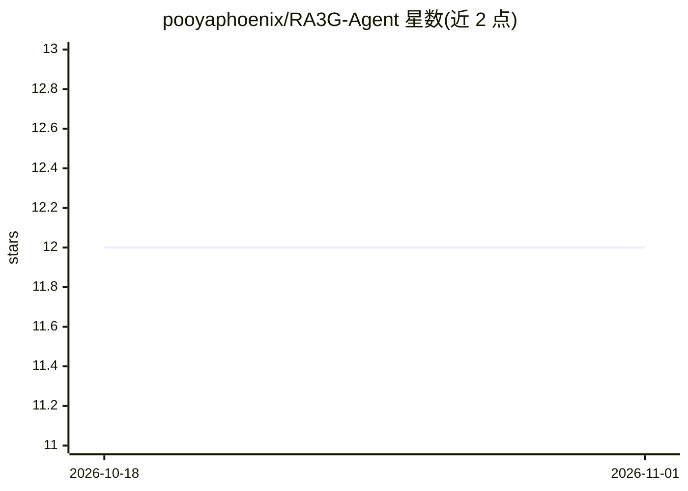

# pooyaphoenix/RA3G-Agent

⭐ 12 · Python · MIT · 推送 2026-08-01 · [GitHub](https://github.com/pooyaphoenix/RA3G-Agent) · 个人维护

**带治理 Agent 的本地 RAG 多智能体问答系统**

本地运行的 RAG 问答系统，采用 Retriever、Reasoning、Governance 三智能体架构：检索器从 FAISS 索引的本地文档语料中查找相关段落，推理 Agent 通过 Ollama LLM（默认 qwen2.5:7b-instruct）生成回答，治理 Agent 按策略过滤敏感信息（个人姓名、电话、医疗记录、企业机密、可配置禁语）。提供 Streamlit Web UI、FastAPI REST API（查询/健康检查/会话追踪/日志流），支持 PDF 上传、会话记忆与实时日志。部署方式为 Docker Compose 或本地 Python 运行，依赖 Python 3.8+ 与 Ollama。

## 筛选速览

| 维度 | 判定 | 备注 |
|---|---|---|
| AI 角色 | `ai-native` | 本体是模型或模型工具 |
| 许可风险 | `permissive` | MIT |
| 部署形态 | `self-host` | docker 或自建部署 |
| 模型依赖 | local-ok | 支持本地模型 |
| 硬件要求 | — | 无带数字的原话,不猜 |
| 安装摩擦 | `low` | 无编译、无系统依赖或容器化 |
| 成熟度 | — | 结构信号不足 |

## 能力要点

- Retriever/Reasoning/Governance 三智能体架构
- 治理 Agent 自动按策略阻断或放行敏感查询与回答
- Streamlit Web UI 与 FastAPI REST API（含 SSE 实时日志流）
- 本地 FAISS 索引，支持 .txt/.md 语料与 PDF 上传，无需外部 API

## 适用场景

- 在本地对自有文档做带敏感信息过滤的问答
- 通过 API 将带治理策略的 RAG 问答集成到其他系统
- 对查询与回答做合规性管控并留存会话与日志

## 场景标签

`多智能体` `RAG` `文档问答` · 领域:Agent 开发

## 证据(README 行号)

> L41: - 🔍 **Local RAG System** - Query your documents without external APIs
> L60: 1. **Retriever Agent** - Finds relevant passages from your corpus
> L61: 2. **Reasoning Agent** - Generates answers using Ollama LLM

## 星数曲线

2026-10-18 12 → 2026-11-01 12（+0）

---
*卡片 v1 · prompt 1.4 · 生成 2026-11-01 · 置信度 mid · 依据 README sha `6cd5bf9f89b5` · [字段定义](../../DATASET.md)*
