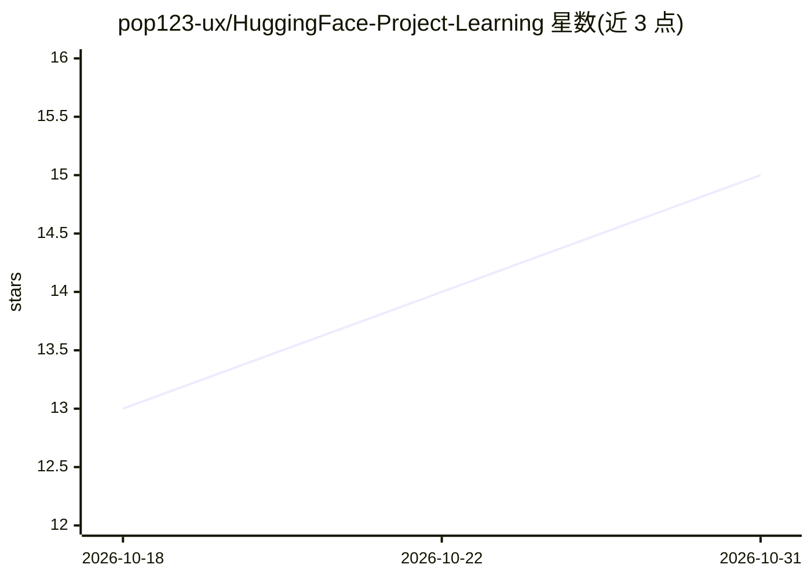

# pop123-ux/HuggingFace-Project-Learning

⭐ 15 · Jupyter Notebook · NOASSERTION · 推送 2026-10-09 · [GitHub](https://github.com/pop123-ux/HuggingFace-Project-Learning) · 个人维护

**Hugging Face 课程实践笔记本集：38 个可运行的 NLP/LLM 学习路径**

个人学习型仓库（非库），按 Hugging Face LLM Course 与 Reasoning Course 为主线整理的 38 个笔记本，多数保留执行输出，可在 Colab 直接打开。内容从 tokenizers、Trainer、datasets 到 LoRA、SFT、GRPO（手写/trl/unsloth 三种实现），并含自研的罗马尼亚语抽取式问答项目（单语与多语 BERT 对比）。README 明确标注各部分材料来源归属；本地运行需 pip 安装 requirements.txt，部分重依赖笔记本在首单元格内自行安装。

## 筛选速览

| 维度 | 判定 | 备注 |
|---|---|---|
| AI 角色 | `ai-knowledge` | 知识聚合/清单类 |
| 许可风险 | `none` | NOASSERTION |
| 部署形态 | `library` | 以包/库形式分发 |
| 模型依赖 | — | README 未给出锁定关系 |
| 硬件要求 | — | 无带数字的原话,不猜 |
| 安装摩擦 | `low` | 无编译、无系统依赖或容器化 |
| 成熟度 | — | 结构信号不足 |

## 能力要点

- 38 个笔记本覆盖基础→微调→GRPO 推理训练→端到端项目的递进路径
- GRPO 三种实现：纯 PyTorch 手写、trl、unsloth+vllm
- 罗马尼亚语 QA 项目：按文章切分 train/test 的修正评估（避免 98.3% 上下文泄漏）
- WordPiece 与 Unigram 算法从零实现

## 适用场景

- 系统学习 Hugging Face 生态从基础到 LLM 微调
- 参考 GRPO 从零实现理解算法原理
- 查看带输出的笔记本了解训练实际发生了什么

## 场景标签

`教程课程` · 领域:学习与行业

## 证据(README 行号)

> L6: This is a learning repository, not a library. Most of it follows the Hugging Face LLM Course and Reasoning Course wi
> L158: |`course/`|Follows the Hugging Face LLM Course curriculum. The course designs the exercises; the notebooks here ar

## 星数曲线

2026-10-18 13 → 2026-10-31 15（+2）

---
*卡片 v1 · prompt 1.4 · 生成 2026-10-30 · 置信度 high · 依据 README sha `f3c86251b69f` · [字段定义](../../DATASET.md)*
