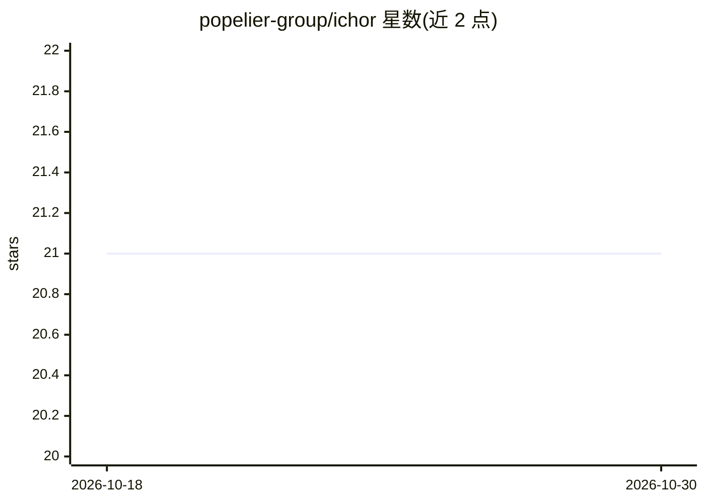

# popelier-group/ichor

⭐ 21 · Python · MIT · 推送 2026-10-07 · [GitHub](https://github.com/popelier-group/ichor) · [官网](https://ichor.readthedocs.io/) · 组织维护

**计算化学数据管理 Python 库，辅助机器学习力场开发**

Python 包，面向计算化学与机器学习力场开发场景的数据管理：提供对各类计算化学软件的读写接口以切换软件并比较结果，用可扩展数据结构管理数十万级计算文件，集成常见数据库格式，封装 SGE/SLURM 工作负载管理器实现计算集群作业自动提交，并附带机器学习数据集/模型分析与分子动力学基准测试工具。分为 ichor.core、ichor.hpc、ichor.cli 三个子包，CLI 需在用户主目录配置 ichor_config.yaml。文件管理与 HPC 部分也可用于非计算化学数据，但代码焦点是计算化学。MIT 许可，作者要求引用两篇论文。

## 筛选速览

| 维度 | 判定 | 备注 |
|---|---|---|
| AI 角色 | `ai-ecosystem` | LLM/agent 周边工具 |
| 许可风险 | `permissive` | MIT |
| 部署形态 | `None` |  |
| 模型依赖 | — | README 未给出锁定关系 |
| 硬件要求 | — | 无带数字的原话,不猜 |
| 安装摩擦 | `low` | 无编译、无系统依赖或容器化 |
| 成熟度 | — | 结构信号不足 |

## 能力要点

- 对多种计算化学软件的接口，支持切换与结果比较
- 数十万级计算文件的数据结构与数据库格式集成
- SGE/SLURM 集群作业自动提交
- 机器学习数据集/模型分析与分子动力学基准测试工具集

## 适用场景

- 批量管理多个计算化学程序产生的大量计算输出
- 在 SGE/SLURM 集群上自动化提交计算作业
- 为机器学习力场开发整理与分析训练数据

## 场景标签

 · 领域:计算化学/科学数据管理

## 证据(README 行号)

> L9: `ichor` is a Python package used to simplify data management from computational chemistry programs and aid with mach
> L19: Realistically, the file management portion of `ichor` (as well as the workload manager integration) is very general

## 星数曲线

2026-10-18 21 → 2026-10-30 21（+0）

---
*卡片 v1 · prompt 1.4 · 生成 2026-10-28 · 置信度 high · 依据 README sha `4b88dca93f7c` · [字段定义](../../DATASET.md)*
