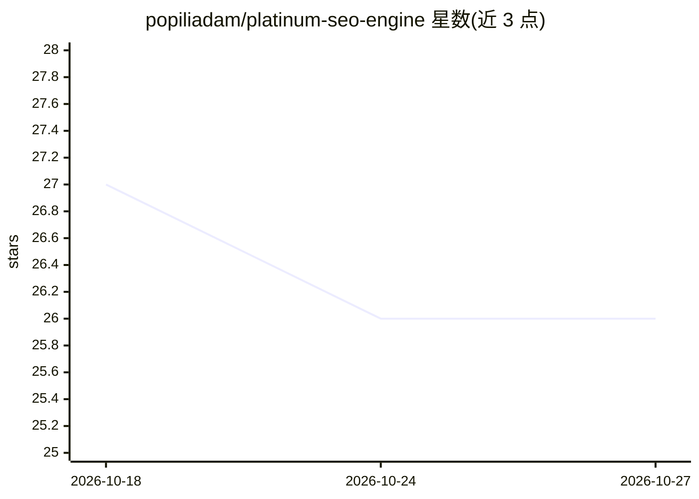

# popiliadam/platinum-seo-engine

⭐ 26 · Python · AGPL-3.0 · 推送 2026-10-19 · [GitHub](https://github.com/popiliadam/platinum-seo-engine) · 个人维护

**Claude Code 插件：把 SEO 运营变成受契约约束的可审计工作流**

面向 SEO 运营者与代理机构的 Claude Code 插件：50 个技能覆盖 GSC/DataForSEO/Screaming Frog/Scrapling 数据摄取、站内审计、内容规划、索引提交与报告。所有工作流的输入输出经 JSON Schema 校验，状态以 events.jsonl 追加记录，drift-check 技能做只读治理审计（30+ 不变量）；插件与数据分双仓存放，项目无关。依赖 Python 3.11+、Node.js 18+ 与多个第三方 API 凭据；部分套件标注 wip。

## 筛选速览

| 维度 | 判定 | 备注 |
|---|---|---|
| AI 角色 | `ai-ecosystem` | LLM/agent 周边工具 |
| 许可风险 | `viral` | AGPL-3.0 |
| 部署形态 | `library` | 以包/库形式分发 |
| 模型依赖 | — | README 未给出锁定关系 |
| 硬件要求 | — | 无带数字的原话,不猜 |
| 安装摩擦 | `low` | 无编译、无系统依赖或容器化 |
| 成熟度 | — | 结构信号不足 |

## 能力要点

- 50 个技能、31 个斜杠命令、6 个 MCP 服务器（含 Screaming Frog 24 HTTP MCP）
- JSON Schema 校验 + 追加式事件日志 + drift-check 自审计
- 插件/工作区双仓分离，同一引擎驱动任意站点组合
- CI 运行 schema 校验、drift-check、lint 与 pytest

## 适用场景

- 在 Claude Code 内完成从 GSC 摄取到月报的完整 SEO 循环
- 多站点组合管理并保留每个决策的审计轨迹
- 数月后重跑或交接项目时复现当时的数字

## 场景标签

`工作流自动化` · 领域:效率与自动化

## 证据(README 行号)

> L17: `platinum-seo-engine` is a **Claude Code plugin** that runs your full SEO operation from inside the editor — keywor
> L21: **The core idea:** *less code, stricter rules, single authority, machine-readable contracts.* Every workflow is a d
> L203: - **Claude Code Plugin SDK** — skills, slash commands, hooks.

## 星数曲线

2026-10-18 27 → 2026-10-27 26（-1）

---
*卡片 v1 · prompt 1.4 · 生成 2026-10-26 · 置信度 mid · 依据 README sha `0c77a3cd9da9` · [字段定义](../../DATASET.md)*
