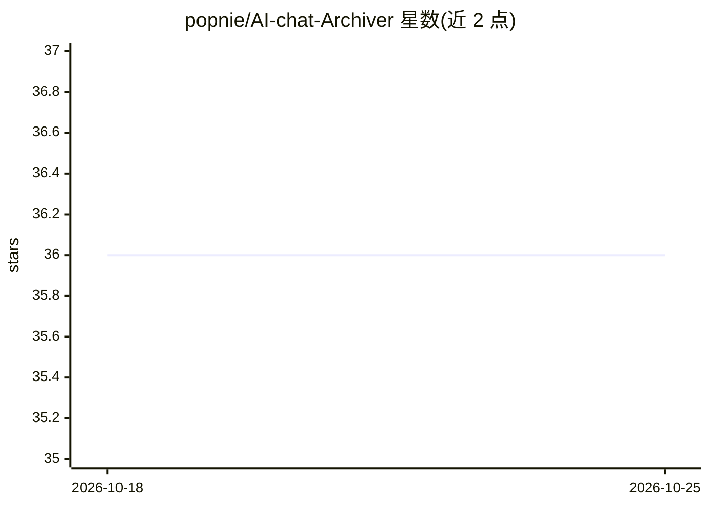

# popnie/AI-chat-Archiver

⭐ 36 · JavaScript · 推送 2026-03-16 · [GitHub](https://github.com/popnie/AI-chat-Archiver) · [官网](https://shiny.zhihuishuju.com/) · 个人维护 · 中文 README

**归档 6 大 AI 平台聊天记录的浏览器扩展**

面向 AI 对话用户的浏览器扩展（Chrome/Firefox），把 ChatGPT、Claude、Gemini、DeepSeek、Kimi、Qwen 六个平台中的聊天内容保存、整理并回看，提供思维导图视图梳理复杂讨论，界面中英双语。本体不生成 AI 内容，定位是让易逝的聊天记录变为可长期复用的资料。安装途径为 Chrome Web Store、Firefox Add-ons 及仓库 Releases 的个人分发版（.crx/文件夹）。

## 筛选速览

| 维度 | 判定 | 备注 |
|---|---|---|
| AI 角色 | `ai-enhanced` | 去掉 AI 部分产品仍成立 |
| 许可风险 | `none` | — |
| 部署形态 | `desktop` | 安装包/桌面程序 |
| 模型依赖 | — | README 未给出锁定关系 |
| 硬件要求 | — | 无带数字的原话,不猜 |
| 安装摩擦 | `low` | 无编译、无系统依赖或容器化 |
| 成熟度 | — | 结构信号不足 |

## 能力要点

- 支持 6 个 AI 平台的聊天内容归档与整理
- 思维导图视图梳理复杂讨论与主题结构
- Chrome/Firefox 双渠道分发，另提供个人分发版离线安装

## 适用场景

- 保存高价值 AI 问答，避免淹没在历史记录里
- 将写作、学习、研究中的零散对话沉淀为长期资料
- 用思维导图复盘复杂主题讨论

## 场景标签

`知识库管理` · 领域:知识与检索

## 证据(README 行号)

> L26: **AI聊天存档大师** 是一款面向 AI 对话场景的浏览器扩展，帮助你将有价值的聊天内容进行归档、整理、回看与展示。
> L47: **AI聊天存档大师** 现已支持 6 大主流 AI 平台的聊天内容归档与整理，适合把分散在不同 AI 产品中的高价值对话统一沉淀下来，方便长期保存、集中回顾和后续复用。

## 星数曲线

2026-10-18 36 → 2026-10-25 36（+0）

---
*卡片 v1 · prompt 1.4 · 生成 2026-10-25 · 置信度 high · 依据 README sha `8a09f1e7820b` · [字段定义](../../DATASET.md)*
