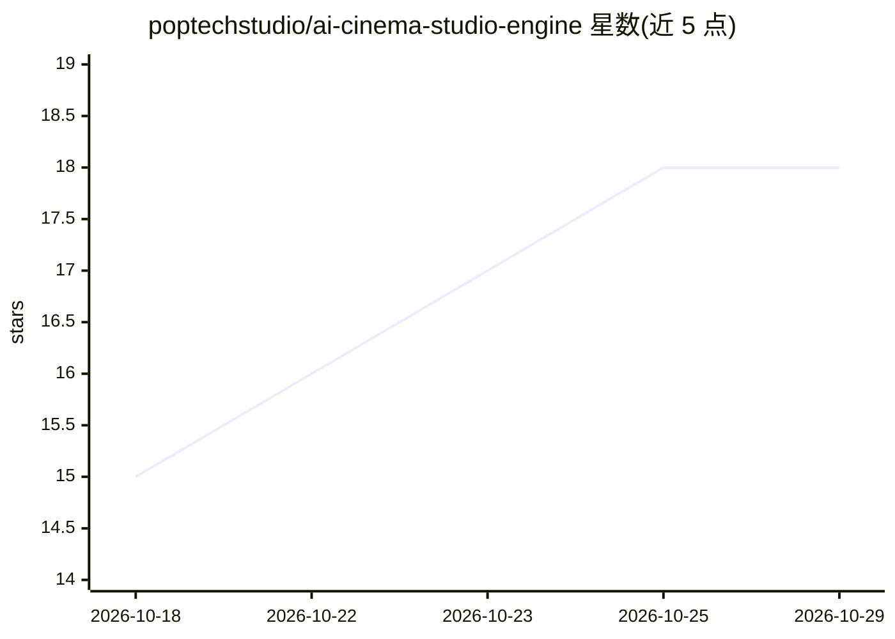

# poptechstudio/ai-cinema-studio-engine

⭐ 18 · Python · MIT · 推送 2026-04-13 · [GitHub](https://github.com/poptechstudio/ai-cinema-studio-engine) · [官网](https://poptechstudio.ai) · 组织维护

**自托管 AI 电影制作引擎：RAG 虚拟摄影 + 五层生产管线**

PopTech Studio 维护的自托管电影级 AI 视频生产管线：以 N8N 编排（5 个工作流、67 节点）、Qdrant 存储 1,645 条摄影预设（1,486 相机、54 灯光、105 效果），每次生成前从向量库装配机身/镜头/焦段/运镜/灯光的技术性提示词；生成层接入 fal.ai（Seedance/Veo/Kling）、Muapi、本地 ComfyUI/Wan 2.6，音频层用 ElevenLabs 与开源 TTS，后期用 Remotion 合成与 FFmpeg 21-LUT 调色，分发层自动发布至 6 平台。要求 Python 3.10+/Node 18+/FFmpeg 7+/Docker，核心引擎需 OpenAI、Qdrant、fal.ai 三个 API key，采用按 API 用量付费模式而非订阅制。

## 筛选速览

| 维度 | 判定 | 备注 |
|---|---|---|
| AI 角色 | `ai-ecosystem` | LLM/agent 周边工具 |
| 许可风险 | `permissive` | MIT |
| 部署形态 | `self-host` | docker 或自建部署 |
| 模型依赖 | locked-api |  |
| 硬件要求 | — | 无带数字的原话,不猜 |
| 安装摩擦 | `low` | 无编译、无系统依赖或容器化 |
| 成熟度 | — | 结构信号不足 |

## 能力要点

- Qdrant RAG 装配 1,645 条摄影预设（相机/镜头/灯光/效果）为生成提示词
- 5 个 N8N 生产工作流（67 节点），含商业片、纪录片、动画等模板
- 多模型生成网关：fal.ai（Seedance 2.0/Veo 3.1/Kling 3.0）、Muapi 200+ 模型、本地 ComfyUI/Wan 2.6
- Remotion 合成 + FFmpeg 21-LUT 调色 + 15 模型口型同步管线

## 适用场景

- 独立电影人或内容工作室用自托管管线替代订阅制视频平台
- 营销机构按 Notion 简报自动跑完生成-合成-调色-多平台发布流程
- 需要精确控制运镜/镜头/灯光参数的电影级 AI 视频生产

## 场景标签

`视频生成` `工作流自动化` · 领域:效率与自动化

## 证据(README 行号)

> L35: |**Orchestration**|Workflow automation, cinematography RAG, project management|N8N workflows, Qdrant (1,645 presets
> L36: |**Generation**|Multi-model video + image + avatar|fal.ai (Seedance 2.0, Kling 3.0, Veo 3.1), Muapi.ai (200+ models
> L96: **Layer 0 — Orchestration + Knowledge:** Qdrant vector DB with 1,645 cinematography presets across 8 collections. N

## 星数曲线

2026-10-18 15 → 2026-10-29 18（+3）

---
*卡片 v1 · prompt 1.4 · 生成 2026-10-29 · 置信度 mid · 依据 README sha `f566d82e9ca8` · [字段定义](../../DATASET.md)*
