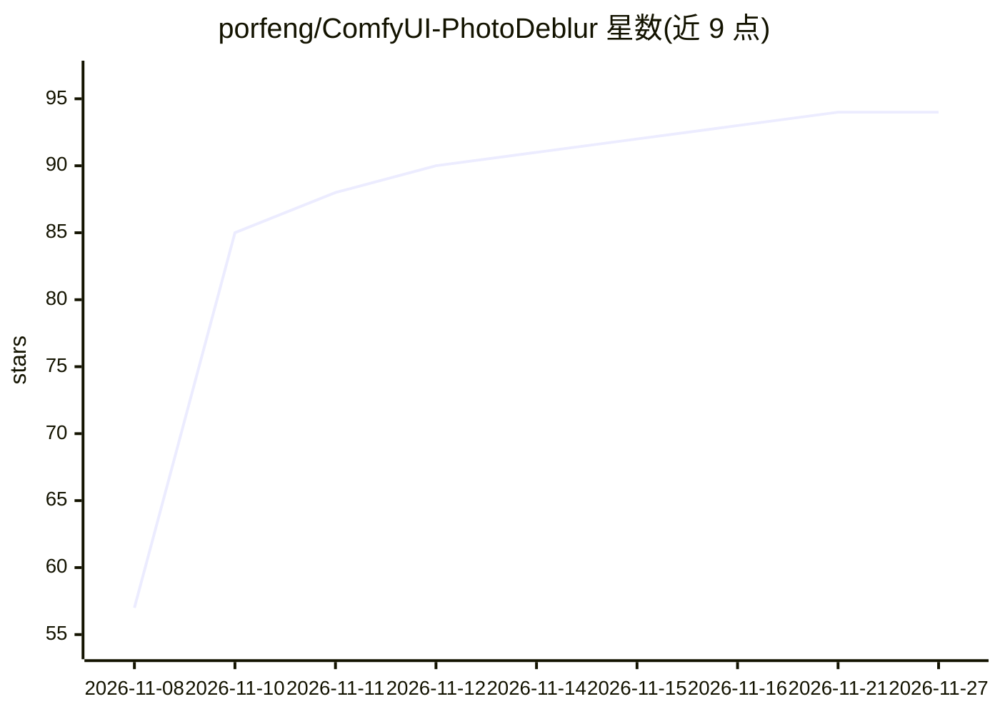

# porfeng/ComfyUI-PhotoDeblur

⭐ 94 · Python · MIT · 推送 2026-11-07 · [GitHub](https://github.com/porfeng/ComfyUI-PhotoDeblur) · 个人维护 · 中文 README

**ComfyUI 照片去模糊节点：HI-Diff/MISCFilter 修复手抖与运动模糊**

为 ComfyUI 提供的原生 HI-Diff 与 MISCFilter 照片去模糊自定义节点及工作流，面向需要修复手持夜景、室内、街景等手抖与运动模糊照片的用户。支持原尺寸分块处理（tile/overlap）、重叠融合、可选 TTA 八次翻转旋转平均、可选色调匹配后处理，并提供下载节点从作者 Google Drive 拉取官方权重并做 SHA256 校验。两模型各有 RealBlur_J/RealBlur_R/GoPro 三变体；MISCFilter 在 NVIDIA/CUDA 12 下需额外安装 CuPy。FP32 原尺寸推理。

## 筛选速览

| 维度 | 判定 | 备注 |
|---|---|---|
| AI 角色 | `ai-native` | 本体是模型或模型工具 |
| 许可风险 | `permissive` | MIT |
| 部署形态 | `desktop` | 安装包/桌面程序 |
| 模型依赖 | — | README 未给出锁定关系 |
| 硬件要求 | — | 无带数字的原话,不猜 |
| 安装摩擦 | `medium` | 含编译或系统依赖之一 |
| 成熟度 | — | 结构信号不足 |

## 能力要点

- HI-Diff 与 MISCFilter 双模型去模糊节点
- 原尺寸分块处理与重叠融合，高分辨率照片保持原始尺寸
- 下载节点自动拉取官方权重并 SHA256 校验
- 可选 TTA（8 次翻转/旋转平均）与色调匹配后处理

## 适用场景

- 修复手持夜景、室内照片的手抖模糊
- 修复街景、建筑、文字边缘的运动模糊
- 高分辨率照片分块去模糊后再裁切或缩放

## 场景标签

`图像视频处理` · 领域:感知与多模态

## 证据(README 行号)

> L5: Native **HI-Diff** and **MISCFilter** photo deblurring nodes for ComfyUI. Supports original-resolution tiled process
> L109: |Deblur Image (Tiled)|Restore the image with tiling, blending and optional TTA|

## 星数曲线

2026-11-08 57 → 2026-11-27 94（+37）

---
*卡片 v1 · prompt 1.4 · 生成 2026-11-17 · 置信度 mid · 依据 README sha `31e2dc9f7b9b` · [字段定义](../../DATASET.md)*
