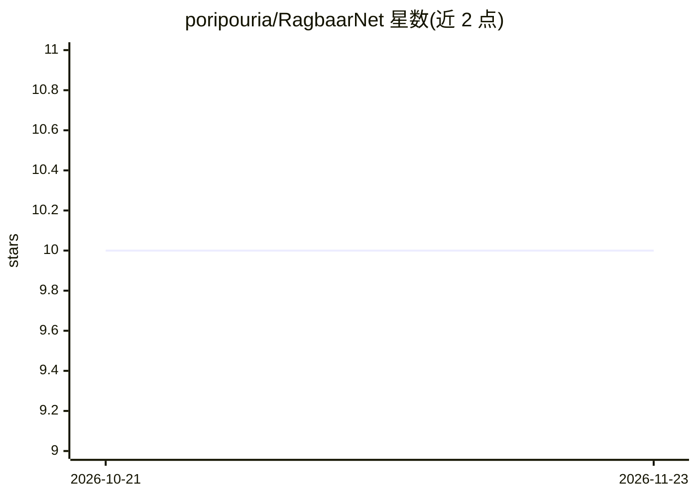

# poripouria/RagbaarNet

⭐ 10 · Python · MIT · 推送 2026-10-15 · [GitHub](https://github.com/poripouria/RagbaarNet) · 个人维护

**面向智能驾驶场景的实时事件驱动音乐生成研究平台**

RagbaarNet 是一个硕士论文研究项目，探索将驾驶场景中的视觉信息实时转化为音乐体验：检测驾驶事件并映射为实时音乐响应。项目尚在进行中（Work in Progress），按感知、事件检测、音乐生成、实时处理组织为模块化组件，强调模块化与向其他事件驱动应用扩展。README 目前未提供安装、运行或使用说明，更多细节待研究方法确定后补充。

## 筛选速览

| 维度 | 判定 | 备注 |
|---|---|---|
| AI 角色 | `ai-native` | 本体是模型或模型工具 |
| 许可风险 | `permissive` | MIT |
| 部署形态 | `None` |  |
| 模型依赖 | — | README 未给出锁定关系 |
| 硬件要求 | — | 无带数字的原话,不猜 |
| 安装摩擦 | `low` | 无编译、无系统依赖或容器化 |
| 成熟度 | `idea` | |

## 能力要点

- 将驾驶视觉信息中的检测事件实时映射为音乐响应
- 按感知/事件检测/音乐生成/实时处理划分的模块化结构
- 面向其他事件驱动应用的可扩展设计

## 适用场景

- 研究驾驶场景事件到实时音乐生成的映射
- 作为事件驱动音乐生成系统的开发起点

## 场景标签

 · 领域:科研/音乐生成

## 证据(README 行号)

> L14: RagbaarNet is a research-oriented platform exploring how meaningful real-time events can be transformed into musica
> L16: The current research direction focuses on interpreting visual information from driving scenarios and mapping detect
> L22: The project is organized into modular components for perception, event detection, music generation, and real-time p

## 星数曲线

2026-10-21 10 → 2026-11-23 10（+0）

---
*卡片 v1 · prompt 1.4 · 生成 2026-11-19 · 置信度 mid · 依据 README sha `640cde9fccf1` · [字段定义](../../DATASET.md)*
