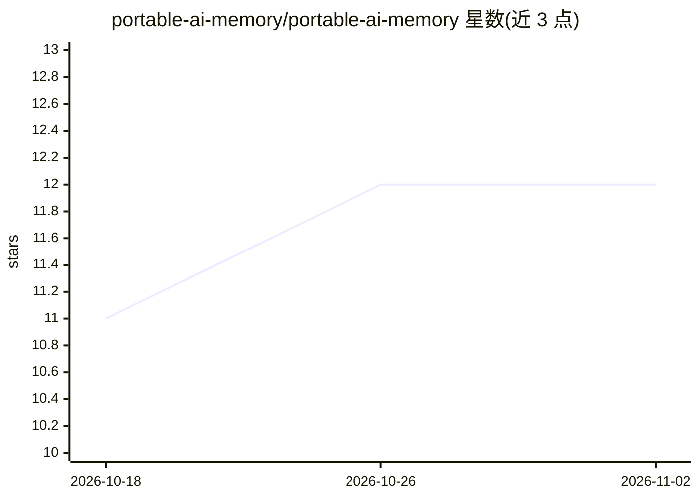

# portable-ai-memory/portable-ai-memory

⭐ 12 · Python · Apache-2.0 · 推送 2026-02-19 · [GitHub](https://github.com/portable-ai-memory/portable-ai-memory) · [官网](https://portable-ai-memory.org) · 个人维护

**AI 用户记忆的跨厂商 JSON 交换格式规范（类 vCard）**

定义 AI 助手积累的用户记忆的厂商中立 JSON 交换规范：涵盖 11 种记忆类型、来源溯源、时间生命周期、置信度衰减、SHA-256 去重、语义关系图、Ed25519/ECDSA 签名、W3C DID 身份与访问控制。仓库提供完整规范、JSON Schema（Draft 2020-12）与示例文件，并文档化 5 家厂商（OpenAI/Anthropic/Google/Microsoft/xAI）导出格式的字段映射；配套 Python SDK 提供 pam validate/convert/inspect 命令。定位是交换而非存储，规范本身零运行时依赖。

## 筛选速览

| 维度 | 判定 | 备注 |
|---|---|---|
| AI 角色 | `ai-ecosystem` | LLM/agent 周边工具 |
| 许可风险 | `permissive` | Apache-2.0 |
| 部署形态 | `library` | 以包/库形式分发 |
| 模型依赖 | — | README 未给出锁定关系 |
| 硬件要求 | — | 无带数字的原话,不猜 |
| 安装摩擦 | `low` | 无编译、无系统依赖或容器化 |
| 成熟度 | — | 结构信号不足 |

## 能力要点

- 11 种记忆类型 + 溯源/生命周期/置信度/签名的标准化 JSON 格式
- 文档化 5 家 AI 厂商导出格式到 PAM 的字段映射
- Python SDK（v1.0.0）支持验证、转换（自动识别厂商）与摘要
- 规范为纯文档 + JSON Schema，零运行时依赖

## 适用场景

- 在不同 AI 助手间迁移我积累的记忆数据
- 统一维护跨多个助手的用户身份与偏好
- 审计并修正 AI 系统对我记录的信息

## 场景标签

`Agent 记忆` · 领域:Agent 开发

## 证据(README 行号)

> L5: PAM is to AI memory what vCard is to contacts and iCalendar is to events — a standardized, vendor-neutral format tha
> L114: 1. **Interchange, not storage** — PAM defines how data is exchanged between systems, not how implementations store
> L116: 2. **Zero runtime dependencies** — the spec is pure documentation and JSON schemas, no code required

## 星数曲线

2026-10-18 11 → 2026-11-02 12（+1）

---
*卡片 v1 · prompt 1.4 · 生成 2026-11-01 · 置信度 high · 依据 README sha `97cd18561a5a` · [字段定义](../../DATASET.md)*
