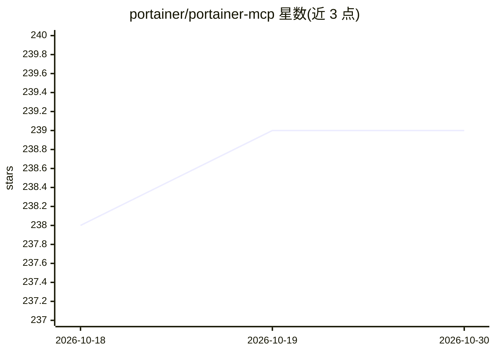

# portainer/portainer-mcp

⭐ 239 · Python · MIT · 推送 2026-10-23 · [GitHub](https://github.com/portainer/portainer-mcp) · [官网](https://portainer.io) · 组织维护

**将 Portainer REST API 暴露为 MCP 工具的官方服务器（已停止支持）**

由 Portainer 官方维护的 MCP server，基于 Portainer OpenAPI spec 用 FastMCP 生成，把 Portainer REST API 暴露为 MCP 工具：列出与检查环境、管理 GitOps 工作流、排查 Docker 与 Kubernetes 资源，并支持代理底层 Docker/K8s API。支持 uvx 本地 stdio、.mcpb 一键安装包和容器化团队部署（含 BYO TLS、反向代理、明文、身份代理四种传输姿态）。需匹配 Portainer 实例的次版本号。README 明确声明：已不再是官方支持的使用方式（由 Portainer Command 取代），按原样提供、无支持与 SLA、不建议用于生产环境，仓库未来可能归档。

## 筛选速览

| 维度 | 判定 | 备注 |
|---|---|---|
| AI 角色 | `ai-ecosystem` | LLM/agent 周边工具 |
| 许可风险 | `permissive` | MIT |
| 部署形态 | `self-host` | docker 或自建部署 |
| 模型依赖 | — | README 未给出锁定关系 |
| 硬件要求 | — | 无带数字的原话,不猜 |
| 安装摩擦 | `low` | 无编译、无系统依赖或容器化 |
| 成熟度 | — | 结构信号不足 |

## 能力要点

- 由 Portainer OpenAPI spec 经 FastMCP 生成的 MCP 工具集
- 支持 Docker 与 Kubernetes 操作及 API 代理
- 三种部署方式：uvx stdio / .mcpb bundle / 容器化 HTTPS 团队部署
- 四种 TLS 传输姿态（BYO 证书/反代/明文/MCP OAuth 身份代理）与能力裁剪配置

## 适用场景

- 让 LLM 客户端直接查询和管理 Portainer 环境与容器资源
- 在 homelab 中通过对话排查 Docker/K8s 问题
- 团队共享部署一个 MCP 入口，各用户以自己的 Portainer API key 行事

## 场景标签

 · 领域:容器编排/DevOps 工具

## 证据(README 行号)

> L3: MCP server for Portainer, generated from the Portainer OpenAPI spec via FastMCP.
> L12: This MCP server exposes the Portainer REST API as MCP tools: list and inspect environments, manage GitOps workflows
> L18: Portainer MCP is intended for evaluation, homelabs, and other non-production use. It is not supported in business, 

## 星数曲线

2026-10-18 238 → 2026-10-30 239（+1）

---
*卡片 v1 · prompt 1.4 · 生成 2026-10-22 · 置信度 high · 依据 README sha `bf4190b150eb` · [字段定义](../../DATASET.md)*
