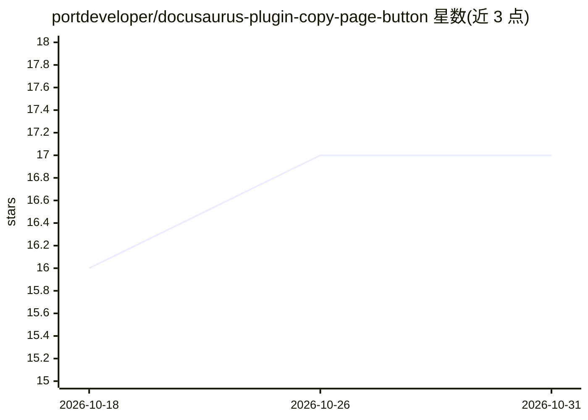

# portdeveloper/docusaurus-plugin-copy-page-button

⭐ 17 · JavaScript · 推送 2026-10-12 · [GitHub](https://github.com/portdeveloper/docusaurus-plugin-copy-page-button) · [官网](https://www.npmjs.com/package/docusaurus-plugin-copy-page-button) · 个人维护

**Docusaurus 文档站插件：一键复制/导出页面为 Markdown 供 AI 工具使用**

面向 Docusaurus 文档站维护者的插件：在文档页注入「Copy page」按钮，可将页面内容提取为 Markdown 复制、在新标签页预览，或直接通过 Open in ChatGPT/Claude/Perplexity/Gemini 链接将页面内容送入 AI 工具。支持配置可见动作（适配私有站点）、可选生成每页 .md 静态路由或复用已有 llms.txt 式 Markdown URL、为暴露 MCP server 的文档站生成 Cursor/VS Code 安装链接，并支持本地化与自定义样式。README 列出多个生产环境使用方。

## 筛选速览

| 维度 | 判定 | 备注 |
|---|---|---|
| AI 角色 | `ai-enhanced` | 去掉 AI 部分产品仍成立 |
| 许可风险 | `permissive` | — |
| 部署形态 | `library` | 以包/库形式分发 |
| 模型依赖 | — | README 未给出锁定关系 |
| 硬件要求 | — | 无带数字的原话,不猜 |
| 安装摩擦 | `low` | 无编译、无系统依赖或容器化 |
| 成熟度 | — | 结构信号不足 |

## 能力要点

- 页面内容一键提取为 Markdown（复制/预览/直达 ChatGPT、Claude、Perplexity、Gemini）
- 可生成每页 .md 静态路由，或将 AI 链接指向已发布的 Markdown URL
- 可选 MCP 动作：复制 MCP JSON 及 Cursor/VS Code 安装链接
- enabledActions 配置、本地化（labels/i18n）与自定义样式

## 适用场景

- 让文档站读者把整页内容快速送入 AI 工具提问或代码审查
- 为文档站暴露 .md URL 便于分享给可抓取 URL 的 AI 工具
- 为暴露 MCP server 的文档站提供 Cursor/VS Code 安装入口

## 场景标签

 · 领域:开发者工具/文档站点

## 证据(README 行号)

> L12: **Extract Docusaurus documentation content as markdown for AI tools like ChatGPT, Claude, Perplexity, and Gemini**
> L79: - 📋 **Copy page as markdown** - Clean page content extraction
> L81: - 🤖 **AI integration** - Direct "Open in ChatGPT", "Open in Claude", "Open in Perplexity", and "Open in Gemini" but

## 星数曲线

2026-10-18 16 → 2026-10-31 17（+1）

---
*卡片 v1 · prompt 1.4 · 生成 2026-10-29 · 置信度 high · 依据 README sha `5171b2a58269` · [字段定义](../../DATASET.md)*
