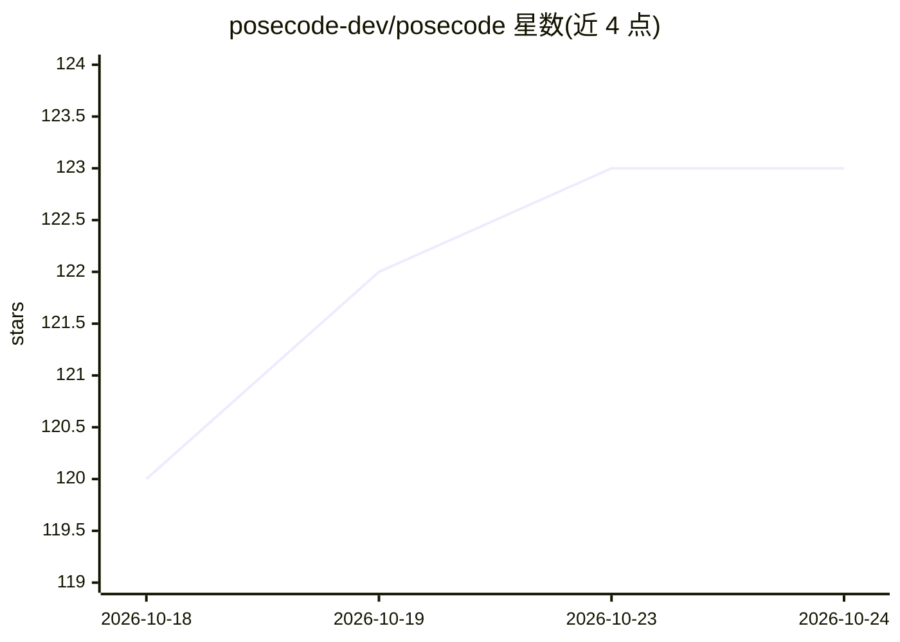

# posecode-dev/posecode

⭐ 124 · TypeScript · Apache-2.0 · 推送 2026-10-12 · [GitHub](https://github.com/posecode-dev/posecode) · [官网](https://www.posecode.org/) · 组织维护

**描述人体运动的文本 DSL：解析、校验并用 Three.js 渲染 3D 动作**

Posecode 是一种开源领域特定语言：以小型 .posecode 文本文档描述人体运动（关节、角度、时序、约束），配套解析器、中间表示、活动度（ROM）校验、正向/逆向运动学与 Three.js/WebGL 渲染器，可在浏览器中实时渲染确定性动作。解析、校验与渲染本身不依赖 AI 模型；同时提供 MCP Server 暴露生成、校验、评审工具供 LLM/agent 调用，供动画工具、LLM 与 Web 产品集成。许可分为 Apache-2.0 标准层与 AGPL-3.0 产品层，并有商业许可路径。

## 筛选速览

| 维度 | 判定 | 备注 |
|---|---|---|
| AI 角色 | `ai-enhanced` | 去掉 AI 部分产品仍成立 |
| 许可风险 | `permissive` | Apache-2.0 |
| 部署形态 | `library` | 以包/库形式分发 |
| 模型依赖 | — | README 未给出锁定关系 |
| 硬件要求 | — | 无带数字的原话,不猜 |
| 安装摩擦 | `low` | 无编译、无系统依赖或容器化 |
| 成熟度 | — | 结构信号不足 |

## 能力要点

- .posecode 文本 DSL 描述关节动作、时序与约束
- 确定性解析、ROM 校验与 Three.js 客户端渲染
- MCP Server 暴露生成/校验/评审/分享工具供 LLM 使用
- Apache-2.0 / AGPL-3.0 分层许可并含商业许可路径

## 适用场景

- 用可读文本编写并渲染 3D 人体动作动画
- 让 LLM/agent 通过 MCP 工具生成与校验动作文档
- Web 产品中嵌入可编程、可校验的运动表示

## 场景标签

 · 领域:动画/运动描述语言

## 证据(README 行号)

> L35: Posecode keeps those decisions in readable source. A human can write the document, an animation tool can emit it, o
> L131: - **Agent-friendly:** the MCP server exposes generation, validation, critique, and sharing tools.
> L153: - a Three.js/WebGL renderer,

## 星数曲线

2026-10-18 120 → 2026-10-24 123（+3）

---
*卡片 v1 · prompt 1.4 · 生成 2026-10-23 · 置信度 high · 依据 README sha `99192e7ffccc` · [字段定义](../../DATASET.md)*
