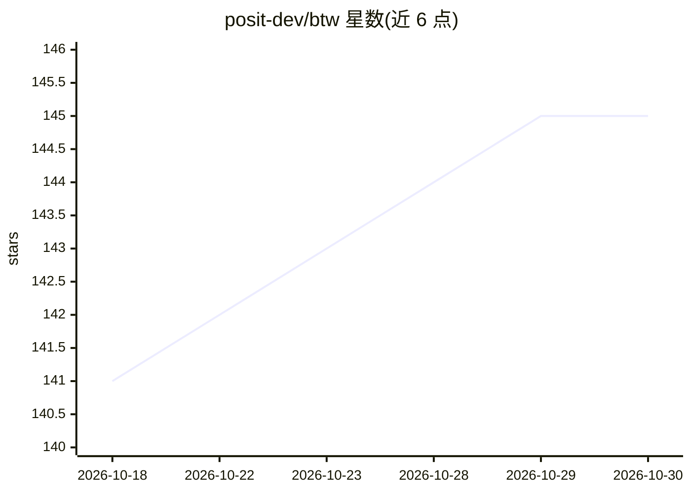

# posit-dev/btw

⭐ 145 · R · NOASSERTION · 推送 2026-10-06 · [GitHub](https://github.com/posit-dev/btw) · [官网](https://posit-dev.github.io/btw/) · 组织维护

**R 与 LLM 连接工具包：为 R 会话提供上下文与 AI 助手**

面向 R 用户的 LLM 工具包，覆盖三种工作流：用 btw() 收集 R 会话上下文（数据结构、包、文档）复制到剪贴板，粘贴给 ChatGPT/Claude 等外部对话界面；用 btw_app() 在 IDE 内启动可读取环境与文档的交互式 AI 助手；用 btw_client()/btw_tools() 将其能力集成到自建应用或 ellmer 聊天客户端，并可经 MCP 协议暴露给 Claude Desktop、Continue 等编码 agent。通过 btw.md 定义项目级 provider、模型与指令。以 R 包形式从 CRAN 安装。

## 筛选速览

| 维度 | 判定 | 备注 |
|---|---|---|
| AI 角色 | `ai-ecosystem` | LLM/agent 周边工具 |
| 许可风险 | `none` | NOASSERTION |
| 部署形态 | `None` |  |
| 模型依赖 | local-ok | 支持本地模型 |
| 硬件要求 | — | 无带数字的原话,不猜 |
| 安装摩擦 | `low` | 无编译、无系统依赖或容器化 |
| 成熟度 | — | 结构信号不足 |

## 能力要点

- btw() 收集 R 会话上下文到剪贴板供外部 LLM 使用
- btw_app() 在 IDE 内启动带工具调用的 AI 助手
- btw_tools() 可注册到任意 ellmer 聊天客户端，按组选择工具
- btw_mcp_server() 经 MCP 协议向外部编码 agent 暴露 R 环境

## 适用场景

- 把 R 会话的数据结构与包信息整理后粘贴给 ChatGPT/Claude 提问
- 在 IDE 内与能读取 R 环境和文档的 AI 助手对话写代码
- 为 Claude Desktop、Continue 等 MCP 工具接入 R 环境能力
- 基于 ellmer 构建带 R 工具的 LLM 应用

## 场景标签

`AI 助手` · 领域:对话与助手

## 证据(README 行号)

> L15: btw helps R users work with Large Language Models, whether you’re
> L79: Or use `btw_tools()` to get a list of tools you can register with any

## 星数曲线

2026-10-18 141 → 2026-10-30 145（+4）

---
*卡片 v1 · prompt 1.4 · 生成 2026-10-22 · 置信度 high · 依据 README sha `7d6f0071777b` · [字段定义](../../DATASET.md)*
