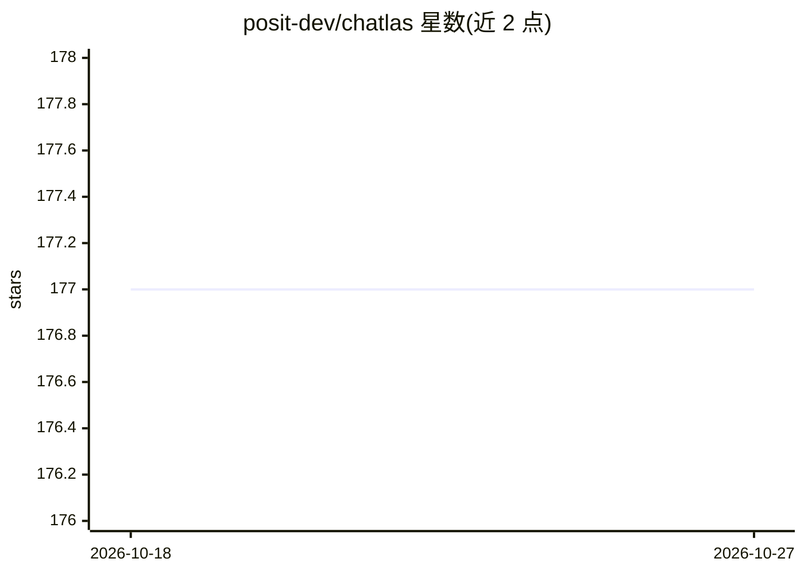

# posit-dev/chatlas

⭐ 177 · Python · MIT · 推送 2026-10-22 · [GitHub](https://github.com/posit-dev/chatlas) · [官网](https://posit-dev.github.io/chatlas/) · 组织维护

**Python LLM 聊天应用构建库，统一多模型提供商接口**

posit-dev 维护的 Python 库，用于构建 LLM 聊天应用：通过统一的 Chat 客户端接口（如 ChatOpenAI、ChatAnthropic）连接不同模型提供商，需先获取各提供商凭证再创建客户端开始对话，支持设置模型与系统提示词。以 PyPI 包或 GitHub 源码安装，MIT 许可，附带测试与文档站点。面向在 Python 中接入多家模型服务的开发者。

## 筛选速览

| 维度 | 判定 | 备注 |
|---|---|---|
| AI 角色 | `ai-ecosystem` | LLM/agent 周边工具 |
| 许可风险 | `permissive` | MIT |
| 部署形态 | `library` | 以包/库形式分发 |
| 模型依赖 | — | README 未给出锁定关系 |
| 硬件要求 | — | 无带数字的原话,不猜 |
| 安装摩擦 | `low` | 无编译、无系统依赖或容器化 |
| 成熟度 | — | 结构信号不足 |

## 能力要点

- 统一 Chat 客户端抽象多个模型提供商（OpenAI、Anthropic 等）
- 支持配置模型与 system_prompt
- PyPI 稳定版与 GitHub 开发版两种安装途径

## 适用场景

- 在 Python 应用中快速接入 LLM 对话能力
- 切换或对比不同模型提供商而少改代码
- 构建聊天机器人原型

## 场景标签

`模型网关` · 领域:Agent 开发

## 证据(README 行号)

> L8: Your friendly guide to building LLM chat apps in Python with less effort and more clarity.
> L28: 1. Choose a model provider, such as ChatOpenAI or ChatAnthropic.

## 星数曲线

2026-10-18 177 → 2026-10-27 177（+0）

---
*卡片 v1 · prompt 1.4 · 生成 2026-10-23 · 置信度 high · 依据 README sha `7dd05332d726` · [字段定义](../../DATASET.md)*
