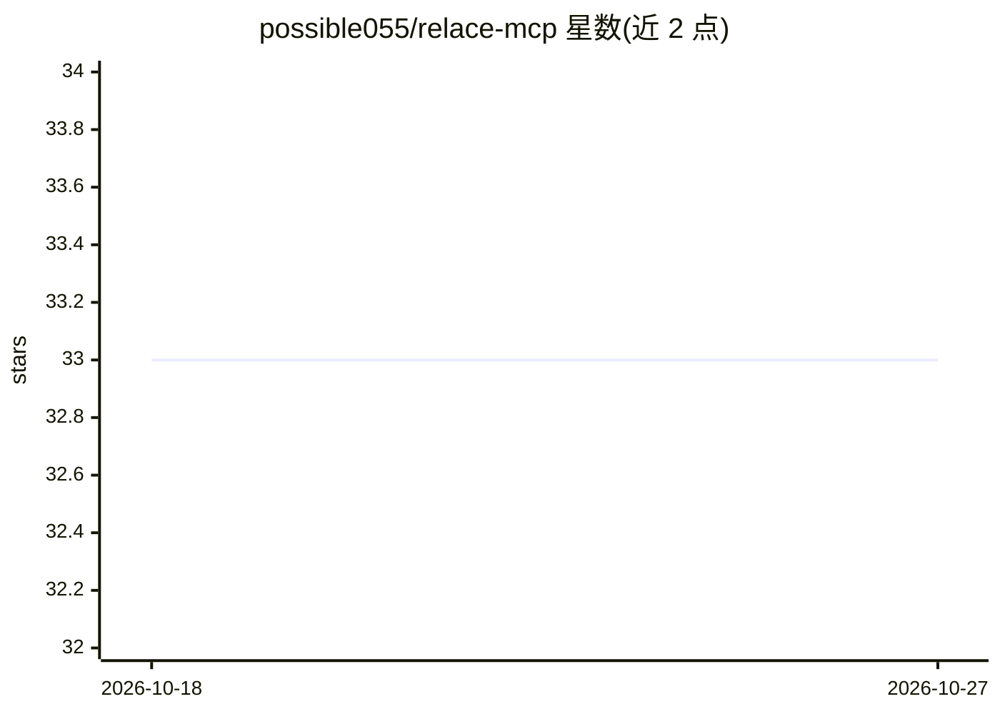

# possible055/relace-mcp

⭐ 33 · Python · MIT · 推送 2026-08-05 · [GitHub](https://github.com/possible055/relace-mcp) · 个人维护 · 中文 README

**非官方 Relace MCP 服务器：AI 代码编辑与代码库检索工具**

面向 MCP 客户端（Cursor、Claude Code、Windsurf、VS Code、Codex CLI）的 MCP 服务器，封装 Relace API 提供 fast_apply 代码合并编辑（10,000+ tokens/sec）、自然语言 agentic_search 代码库探索，以及可选的混合语义检索（relace/codanna/chunkhound 后端）与云端语义搜索。Relace 后端需 API key，非 Relace 后端组合下可免 key。Python 3.11+ 编写，通过 PyPI/uv 安装，附终端监控面板与 Loc-Bench 基准测试。Windows 上 bash 工具不可用，建议 WSL。作者声明为个人项目、非 Relace 官方、代码由 AI 辅助生成。

## 筛选速览

| 维度 | 判定 | 备注 |
|---|---|---|
| AI 角色 | `ai-ecosystem` | LLM/agent 周边工具 |
| 许可风险 | `permissive` | MIT |
| 部署形态 | `library` | 以包/库形式分发 |
| 模型依赖 | — | README 未给出锁定关系 |
| 硬件要求 | — | 无带数字的原话,不猜 |
| 安装摩擦 | `low` | 无编译、无系统依赖或容器化 |
| 成熟度 | — | 结构信号不足 |

## 能力要点

- fast_apply 经 Relace API 以 10,000+ tokens/sec 应用代码编辑
- agentic_search 以自然语言查询做代码库探索
- 可选混合检索后端：relace/codanna/chunkhound/none
- 提供 relogs 终端监控面板与 Loc-Bench 代码定位基准

## 适用场景

- 在 Cursor/Claude Code 等 MCP 客户端中以自然语言定位并修改代码
- 让 AI 编码助手进行跨文件、保持导入一致的编辑
- 监控与基准测试 agentic_search 的定位表现

## 场景标签

`编码 Agent` `语义搜索` · 领域:编码与开发

## 证据(README 行号)

> L15: MCP server providing AI-powered code editing and intelligent codebase exploration tools.
> L114: Always available: `fast_apply`, `agentic_search`. `agentic_retrieval` requires `MCP_SEARCH_RETRIEVAL=1`. Cloud too

## 星数曲线

2026-10-18 33 → 2026-10-27 33（+0）

---
*卡片 v1 · prompt 1.4 · 生成 2026-10-25 · 置信度 mid · 依据 README sha `b16282326707` · [字段定义](../../DATASET.md)*
