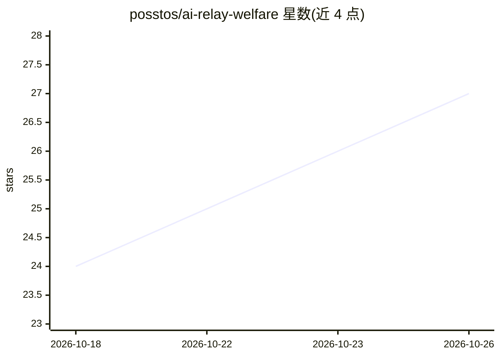

# posstos/ai-relay-welfare

⭐ 27 · Python · MIT · 推送 2026-10-18 · [GitHub](https://github.com/posstos/ai-relay-welfare) · [官网](https://posstos.github.io/ai-relay-welfare/) · 个人维护 · 中文 README

**36 个 AI 中转站邀请链接合集，含签到状态与实测备注**

收录 36 个第三方 AI API 中转站的邀请链接，按签到状态分为有每日签到（18 个）、未开签到（10 个）、受限/待实测（8 个）三类，每条附实测备注（模型数量、免费分组倍率、验证码门槛、注册注意事项）与邀请码。注册后在站点后台建 Key，客户端将 Base URL 指向站点 /v1 即可使用，协议多为 OpenAI 兼容。仓库声明仅做链接收集，数据源为 sites.json，可用脚本重新生成 README 与网页版。

## 筛选速览

| 维度 | 判定 | 备注 |
|---|---|---|
| AI 角色 | `ai-knowledge` | 知识聚合/清单类 |
| 许可风险 | `permissive` | MIT |
| 部署形态 | `None` |  |
| 模型依赖 | — | README 未给出锁定关系 |
| 硬件要求 | — | 无带数字的原话,不猜 |
| 安装摩擦 | `low` | 无编译、无系统依赖或容器化 |
| 成熟度 | — | 结构信号不足 |

## 能力要点

- 36 个中转站邀请链接，标注必须带邀请参数注册才有额度奖励
- 按签到可用性分类：18 个支持每日签到、10 个未开、8 个受限/待测
- 每站附实测备注：模型数、免费分组倍率、人机验证门槛、注册建议
- 数据源 sites.json，python scripts/build.py 重新生成 README 与网页版

## 适用场景

- 寻找有免费额度或签到的 AI 中转站并获取邀请注册奖励
- 比较各站签到门槛、免费分组倍率与模型覆盖
- 为 Claude Code / Codex CLI 等工具找一个 OpenAI 兼容的 Base URL

## 场景标签

`精选清单` · 领域:学习与行业

## 证据(README 行号)

> L1: AI 中转站福利导航
> L95: > 收录 `36` 个站，其中 `18` 个确认支持每日签到。数据更新：`2026-10-18`。
> L161: - 本仓库**仅做链接收集与实测记录**，与任何站点均无隶属或合作关系。

## 星数曲线

2026-10-18 24 → 2026-10-26 27（+3）

---
*卡片 v1 · prompt 1.4 · 生成 2026-10-26 · 置信度 high · 依据 README sha `0c51dfa3173b` · [字段定义](../../DATASET.md)*
