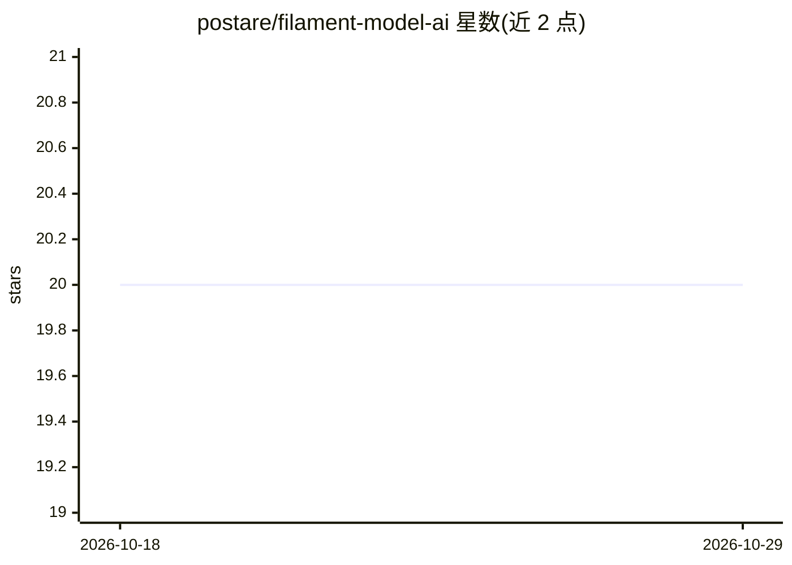

# postare/filament-model-ai

⭐ 20 · PHP · MIT · 推送 2025-11-05 · [GitHub](https://github.com/postare/filament-model-ai) · 个人维护

**FilamentPHP 插件：用 Eloquent 模型数据作为上下文调用 OpenAI 生成内容**

Laravel/FilamentPHP 的 Composer 包，封装 OpenAI API 调用：用户在面板页面中选择 Eloquent 模型记录与提示词，插件将记录数据作为上下文发送给 OpenAI，生成营销文案、商品描述等内容。提供面板内页面与 ModelAi::chat() 编程接口，支持覆盖默认模型，需在 .env 配置 OPENAI_API_KEY，可发布配置与视图文件。功能包含 OpenAI API 集成、自定义模型与提示词。

## 筛选速览

| 维度 | 判定 | 备注 |
|---|---|---|
| AI 角色 | `ai-ecosystem` | LLM/agent 周边工具 |
| 许可风险 | `permissive` | MIT |
| 部署形态 | `None` |  |
| 模型依赖 | — | README 未给出锁定关系 |
| 硬件要求 | — | 无带数字的原话,不猜 |
| 安装摩擦 | `low` | 无编译、无系统依赖或容器化 |
| 成熟度 | — | 结构信号不足 |

## 能力要点

- 以 Eloquent 模型记录数据作为 OpenAI 请求上下文
- FilamentPHP 面板页面选择记录、模型与提示词
- 提供 ModelAi::chat() 编程接口，可覆盖默认 OpenAI 模型

## 适用场景

- 为房产房源生成社交媒体营销内容
- 为电商商品（如葡萄酒）生成商品描述与搭配推荐
- 在 FilamentPHP 后台直接调用 OpenAI 生成内容

## 场景标签

`AI 写作` · 领域:内容生成

## 证据(README 行号)

> L3: ModelAI is a plugin designed for FilamentPHP that interfaces with OpenAI APIs. Its primary function is to use existi
> L54: In addition to a page in your Panel where you can select the desired element, the Model, and the Prompt, you can al

## 星数曲线

2026-10-18 20 → 2026-10-29 20（+0）

---
*卡片 v1 · prompt 1.4 · 生成 2026-10-28 · 置信度 high · 依据 README sha `ef0049addd4d` · [字段定义](../../DATASET.md)*
