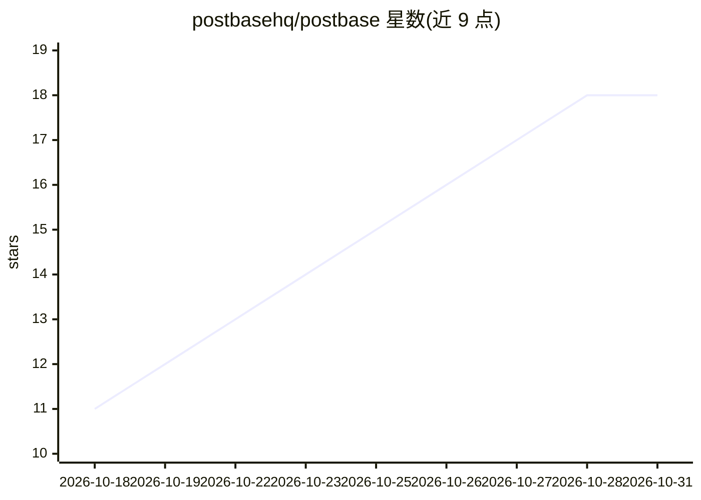

# postbasehq/postbase

⭐ 18 · TypeScript · AGPL-3.0 · 推送 2026-10-29 · [GitHub](https://github.com/postbasehq/postbase) · [官网](https://www.postbase.so) · 组织维护

**开源社交媒体排程器，支持 MCP 让 AI 客户端代发帖**

基于 Next.js + Supabase 的开源社交媒体排程工具：连接 X、LinkedIn、Bluesky、Mastodon、TikTok、YouTube 渠道，撰写并定时发布帖子。核心机制是 MCP 原生——Claude、ChatGPT、Cursor 等 MCP 客户端可通过托管 MCP 服务器（OAuth）或 @postbasehq/mcp npm 包（API key）调用 list_channels、create_post 等工具代为排程；应用内也内置聊天式 AI agent 起草帖子。支持免费自托管或使用托管云，采用 AGPL-3.0 许可证。

## 筛选速览

| 维度 | 判定 | 备注 |
|---|---|---|
| AI 角色 | `ai-enhanced` | 去掉 AI 部分产品仍成立 |
| 许可风险 | `viral` | AGPL-3.0 |
| 部署形态 | `library` | 以包/库形式分发 |
| 模型依赖 | — | README 未给出锁定关系 |
| 硬件要求 | — | 无带数字的原话,不猜 |
| 安装摩擦 | `low` | 无编译、无系统依赖或容器化 |
| 成熟度 | — | 结构信号不足 |

## 能力要点

- MCP 原生：Claude/ChatGPT/Cursor 等 MCP 客户端可代为起草和排程帖子
- 内置聊天式 AI agent，确认后自动排程
- 支持 X/LinkedIn/Bluesky/Mastodon/TikTok/YouTube 六渠道定时发布
- 提供 REST API，自托管与托管云为同一产品

## 适用场景

- 在一个面板中统一管理和定时发布多平台社交媒体内容
- 让 Claude/ChatGPT/Cursor 等 AI 客户端通过 MCP 直接代我发帖排程
- 自托管一个可控的开源排程服务替代商业排程工具

## 场景标签

`工作流自动化` `AI 写作` · 领域:效率与自动化

## 证据(README 行号)

> L5: Postbase is an open-source, **MCP-native** social media
> L14: - **Built-in AI agent** — a chat in the app that drafts posts and schedules them

## 星数曲线

2026-10-18 11 → 2026-10-31 18（+7）

---
*卡片 v1 · prompt 1.4 · 生成 2026-10-29 · 置信度 high · 依据 README sha `ca3785b4e16c` · [字段定义](../../DATASET.md)*
