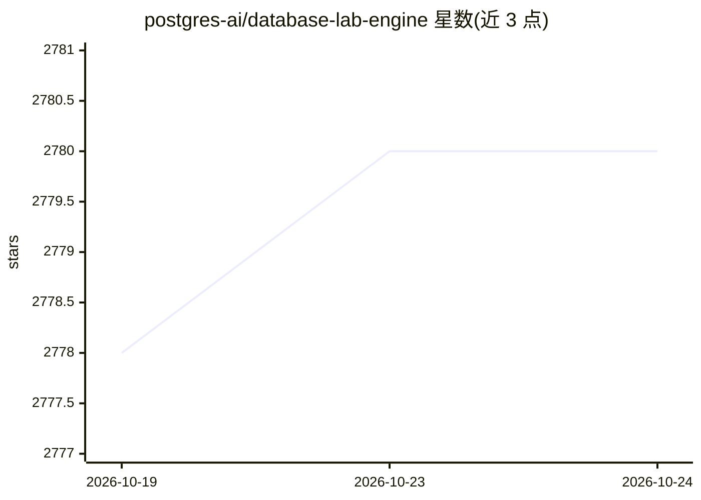

# postgres-ai/database-lab-engine

⭐ 2,778 · Go · Apache-2.0 · 推送 2026-10-22 · [GitHub](https://github.com/postgres-ai/database-lab-engine) · [官网](https://postgres.ai/products/how-it-works) · 组织维护

**PostgreSQL 数据库秒级克隆与分支工具，服务开发测试环境**

面向开发/QA/运维的 PostgreSQL 精简克隆引擎：基于 ZFS（默认）或 LVM 的 Copy-on-Write 技术，从生产级数据生成独立数据库克隆与分支，用于构建开发/测试/预发环境、在 CI/CD 中覆盖数据库迁移测试，并支持克隆就地升级 PostgreSQL 主版本（pg_upgrade --link）、PITR、资源配额与 Prometheus 监控。兼容自管及托管 PostgreSQL（AWS RDS、GCP Cloud SQL、Azure 等），以 Docker 容器打包各组件，提供 UI、CLI 与 API。对托管云数据库源需在同区域单独 VM 运行。

## 筛选速览

| 维度 | 判定 | 备注 |
|---|---|---|
| AI 角色 | `ai-enhanced` | 去掉 AI 部分产品仍成立 |
| 许可风险 | `permissive` | Apache-2.0 |
| 部署形态 | `None` |  |
| 模型依赖 | — | README 未给出锁定关系 |
| 硬件要求 | — | 无带数字的原话,不猜 |
| 安装摩擦 | `low` | 无编译、无系统依赖或容器化 |
| 成熟度 | — | 结构信号不足 |

## 能力要点

- 基于 ZFS/LVM 的 CoW 精简克隆，1 TiB 数据库克隆约 10 秒
- 支持 PostgreSQL 10–18，克隆可就地升级到更新的主版本
- 物理（pg_basebackup/WAL-G/pgBackRest）与逻辑（dump/restore）两种数据获取模式
- 各组件以 Docker 容器打包，提供 UI/CLI/API 及 Prometheus 指标端点

## 适用场景

- 用生产级全量数据快速搭建开发/QA/预发环境
- CI/CD 流水线中自动测试数据库变更，降低生产事故风险
- 为 SQL 查询分析与优化提供临时全尺寸克隆
- 用接近生产的数据验证 LLM 生成的 SQL/方案是否可行

## 场景标签

 · 领域:数据库基础设施/DevOps

## 证据(README 行号)

> L9:  ⚡ Blazing-fast PostgreSQL cloning and branching 🐘
> L12:  💡 Quickly verify ChatGPT ideas to get rid of hallucinations.
> L38: - Rapidly validate ChatGPT or other LLM concepts, check for hallucinations, and iterate towards effective solutions

## 星数曲线

2026-10-19 2,778 → 2026-10-24 2,780（+2）

---
*卡片 v1 · prompt 1.4 · 生成 2026-10-21 · 置信度 mid · 依据 README sha `235297dd5b00` · [字段定义](../../DATASET.md)*
