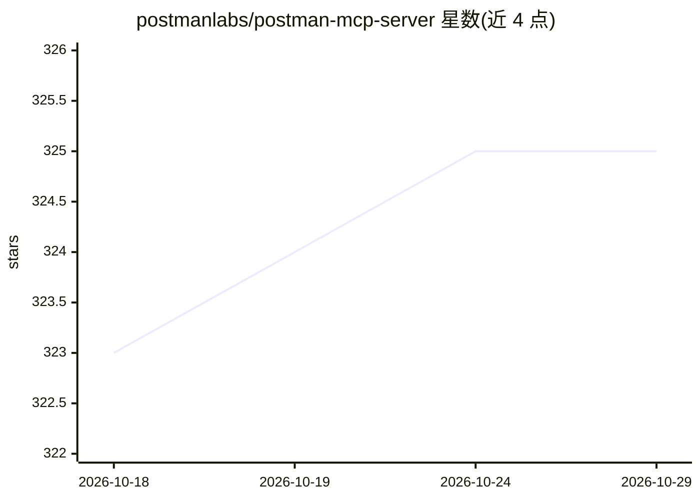

# postmanlabs/postman-mcp-server

⭐ 325 · TypeScript · Apache-2.0 · 推送 2026-10-23 · [GitHub](https://github.com/postmanlabs/postman-mcp-server) · [官网](https://www.postman.com/product/mcp-server/) · 组织维护

**将 AI 编码代理接入 Postman 集合与 API 规范的 MCP 服务器**

Postman 官方维护的 Model Context Protocol (MCP) 服务器，把 Claude Code、Cursor、VS Code Copilot 等 AI 代理与编码助手连接到 Postman 工作区、集合、规范与环境。提供远程（OAuth 或 API key 认证，含 EU 区域）与本地（npx 包）两种运行方式，四级工具配置（Minimal/Code/Full/Learn，Full 含 100+ 工具），支持 API 测试、代码同步、集合与工作区管理、客户端代码生成等操作。适用对象为使用 Postman 并在 IDE 中使用 AI 代理的开发者。

## 筛选速览

| 维度 | 判定 | 备注 |
|---|---|---|
| AI 角色 | `ai-ecosystem` | LLM/agent 周边工具 |
| 许可风险 | `permissive` | Apache-2.0 |
| 部署形态 | `library` | 以包/库形式分发 |
| 模型依赖 | — | README 未给出锁定关系 |
| 硬件要求 | — | 无带数字的原话,不猜 |
| 安装摩擦 | `low` | 无编译、无系统依赖或容器化 |
| 成熟度 | — | 结构信号不足 |

## 能力要点

- MCP 协议连接 AI 代理与 Postman 工作区/集合/规范/环境
- 四种工具配置：Minimal、Code、Full（100+ 工具）、Learn
- 远程 OAuth 认证与本地 npx 运行，支持 EU 区域与 Docker

## 适用场景

- 在 IDE 中用 AI 代理直接测试与管理 Postman 集合
- 从 API 定义生成客户端代码并保持代码与规范同步
- 让代理跨集合执行创建、打标签、更新文档等操作

## 场景标签

`代码生成` · 领域:编码与开发

## 证据(README 行号)

> L3: The **Postman MCP Server** implements the Model Context Protocol (MCP) to connect AI agents and coding assistants — 
> L19: - **Minimal** — (Default) Only includes essential tools for basic Postman operations. Ideal for users who want to m

## 星数曲线

2026-10-18 323 → 2026-10-29 325（+2）

---
*卡片 v1 · prompt 1.4 · 生成 2026-10-21 · 置信度 high · 依据 README sha `d2ae2cc011e6` · [字段定义](../../DATASET.md)*
