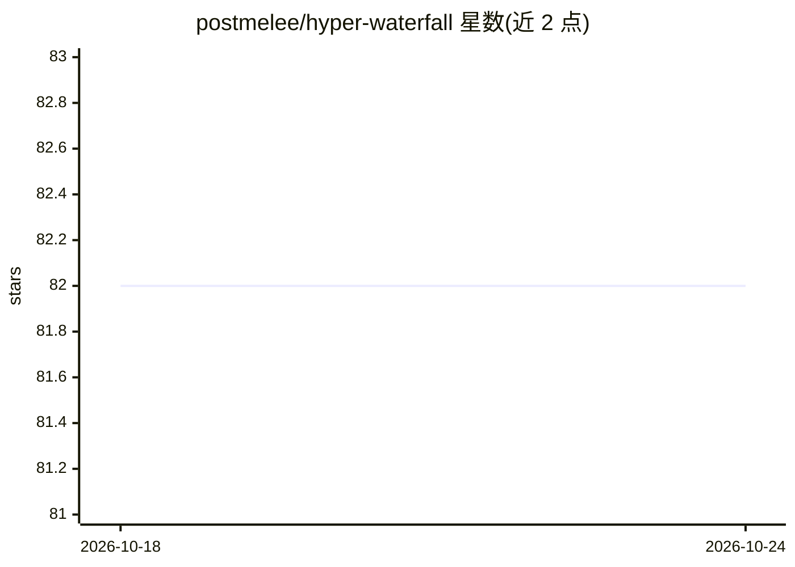

# postmelee/hyper-waterfall

⭐ 82 · JavaScript · MIT · 推送 2026-07-12 · [GitHub](https://github.com/postmelee/hyper-waterfall) · 个人维护 · 中文 README

**人类主导的 AI 编码工作流：把会话上下文沉淀为可复用项目记忆**

一套人机治理的 AI 编码方法论：将临时会话中的意图、决策、进度与验证证据，以 Issue、计划、Stage 报告、commit 与 PR 等结构化工件形式沉淀为持久项目记忆，使新会话、agent 或贡献者可从文档化基线继续工作。工作被拆分为带人工审批门的 Stage，推荐『1 Issue = 1 Task = 1 Branch = 1 Session』的小会话模式。通过向 AI 编码工具发送一句提示（从 docs/agent-entrypoint.en.md 开始）或 npx/brew CLI 采纳，支持 en/ko/zh-CN 三种语言包。

## 筛选速览

| 维度 | 判定 | 备注 |
|---|---|---|
| AI 角色 | `ai-ecosystem` | LLM/agent 周边工具 |
| 许可风险 | `permissive` | MIT |
| 部署形态 | `library` | 以包/库形式分发 |
| 模型依赖 | — | README 未给出锁定关系 |
| 硬件要求 | — | 无带数字的原话,不猜 |
| 安装摩擦 | `low` | 无编译、无系统依赖或容器化 |
| 成熟度 | — | 结构信号不足 |

## 能力要点

- 会话上下文蒸馏为 Issue、Stage 报告、commit、PR 等结构化工件
- 任务计划、实施计划与 Stage 边界处设人工决策门
- 推荐 1 Issue = 1 Task = 1 Branch = 1 Session 的小会话模式
- npx / Homebrew CLI 支持本地初始化（--dry-run 检查）

## 适用场景

- 跨多天、多会话、多 agent 的真实源码改动需要可追溯、可恢复
- 让 Codex、Claude Code 等多种 AI 编码工具在同一纪律与共享上下文下工作
- PR 评审者需要了解改了什么、为什么改、如何验证

## 场景标签

`Agent 记忆` · 领域:Agent 开发

## 证据(README 行号)

> L95: > Hyper-Waterfall lets anyone apply the method to a GitHub repository and makes multiple AI coding agents, includin
> L114: Hyper-Waterfall turns both weaknesses into workflow constraints. It distills work memory into project artifacts an

## 星数曲线

2026-10-18 82 → 2026-10-24 82（+0）

---
*卡片 v1 · prompt 1.4 · 生成 2026-10-24 · 置信度 high · 依据 README sha `5271583ff012` · [字段定义](../../DATASET.md)*
