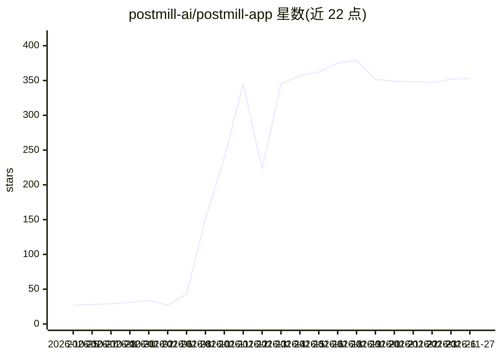

# postmill-ai/postmill-app

⭐ 353 · TypeScript · AGPL-3.0 · 推送 2026-11-22 · [GitHub](https://github.com/postmill-ai/postmill-app) · [官网](https://postmill.ai) · 组织维护

**给代理和品牌团队的开源自助社交媒体管理与发布平台**

自托管社交媒体管理平台，整合设计、发布、排期、分析与互动：可视化发布日历、45+ 渠道统一编辑器、46 个内置媒体工具（含分层图像/视频编辑器与 38 个 BYOK 生成工作室）、持久化跨渠道分析、评论收件箱、活动中心与多品牌管理。AI 层采用 bring-your-own-key，按组织配置 31 个模型/媒体提供商，带提示注入/PII/品牌安全护栏与支出上限。提供自然语言 Agent 操作全平台，外部操作需确认卡片。AGPL-3.0 许可，可自托管或使用托管云。

## 筛选速览

| 维度 | 判定 | 备注 |
|---|---|---|
| AI 角色 | `ai-native` | 本体是模型或模型工具 |
| 许可风险 | `viral` | AGPL-3.0 |
| 部署形态 | `self-host` | docker 或自建部署 |
| 模型依赖 | — | README 未给出锁定关系 |
| 硬件要求 | — | 无带数字的原话,不猜 |
| 安装摩擦 | `low` | 无编译、无系统依赖或容器化 |
| 成熟度 | — | 结构信号不足 |

## 能力要点

- 45+ 渠道单一编辑器排期发布，OAuth 或自有应用密钥接入
- 内置分层图像/多轨视频编辑器与 46 个媒体工具，支持多渠道变体导出
- BYOK AI 层：31 个提供商按组织配置，含 RAG 检索、护栏与审计日志
- 自然语言 Agent 可在应用内或经 Slack/Telegram/Discord/Matrix/LINE 操作平台

## 适用场景

- 为多个客户品牌集中排期和发布社交媒体内容
- 在编辑器内生成素材并直接发布到多渠道
- 通过聊天让 AI Agent 代为排期、生成素材和拉取分析
- 自托管管理团队角色权限与跨渠道评论回复

## 场景标签

`图像生成` `AI 写作` `工作流自动化` · 领域:效率与自动化

## 证据(README 行号)

> L19: **Open-source, AI-native social media management, design and scheduling.**
> L98: Postmill is AI-native from the ground up. A single governed AI layer powers every surface, and you bring your own k

## 星数曲线

2026-10-25 27 → 2026-11-27 353（+326）

---
*卡片 v1 · prompt 1.4 · 生成 2026-11-25 · 置信度 high · 依据 README sha `a1e5e4ee8afa` · [字段定义](../../DATASET.md)*
