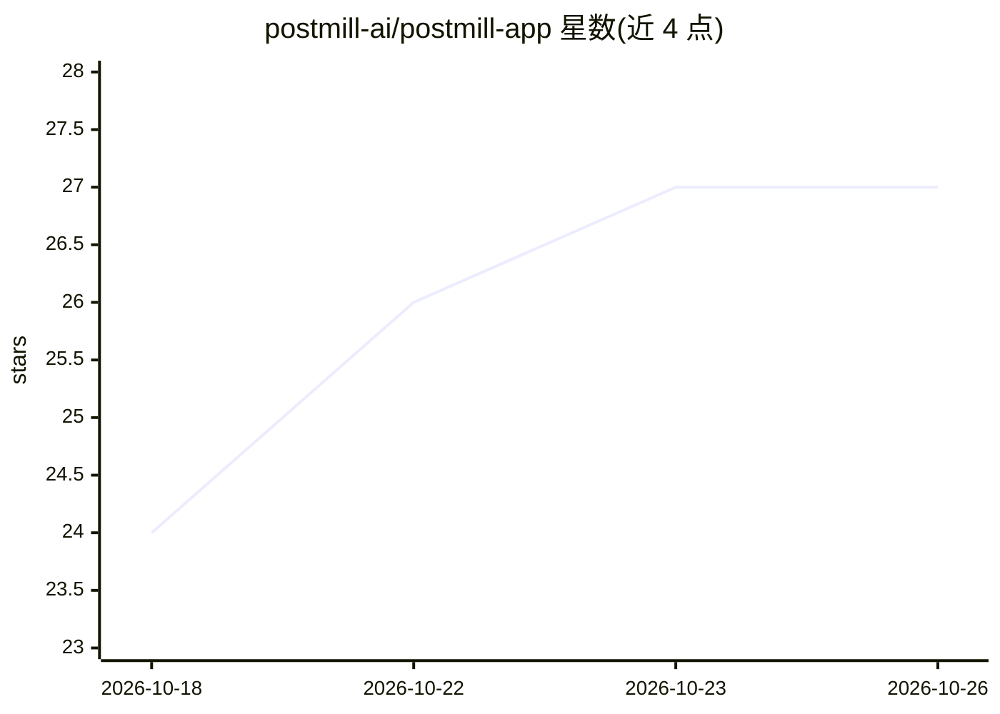

# postmill-ai/postmill-app

⭐ 27 · TypeScript · AGPL-3.0 · 推送 2026-10-24 · [GitHub](https://github.com/postmill-ai/postmill-app) · [官网](https://postmill.ai) · 组织维护

**自托管的多品牌社交媒体管理与排期平台，内嵌 BYOK AI 层**

面向代理商与多品牌团队的自托管社交媒体排期与设计平台：视觉发布日历覆盖 45+ 渠道，内置分层图像/视频设计器与 46 个媒体工具，支持 BYOK 接入 30 个 AI 提供商（17 个直连模型商 + 13 个多模型枢纽），可为文本/视觉/媒体任务分别指定默认模型。AI 治理层提供品牌语气、提示词库、RAG 检索、护栏（提示注入/PII/品牌安全/NSFW）与按组织限额和审计日志。另含自然语言操作全平台的 agent（可经 Slack/Telegram/Discord 等使用）、跨渠道评论收件箱、每日快照持久化分析、活动中心、多品牌管理与 5 内置角色 + 90 权限的 RBAC。许可证 AGPL-3.0，提供 Node SDK 与公共 API，另有托管服务。

## 筛选速览

| 维度 | 判定 | 备注 |
|---|---|---|
| AI 角色 | `ai-native` | 本体是模型或模型工具 |
| 许可风险 | `viral` | AGPL-3.0 |
| 部署形态 | `self-host` | docker 或自建部署 |
| 模型依赖 | — | README 未给出锁定关系 |
| 硬件要求 | — | 无带数字的原话,不猜 |
| 安装摩擦 | `low` | 无编译、无系统依赖或容器化 |
| 成熟度 | — | 结构信号不足 |

## 能力要点

- 45+ 渠道单一编辑器排期发布，含首评自动化与渠道级 VPN 出口
- BYOK 接入 30 个 AI 提供商，文本/视觉/媒体任务可分别指定默认模型
- 内置分层图像/视频设计器 + 38 个 BYOK 生成工作室 + 6 个素材浏览器
- AI 治理：护栏、按组织限额、审计日志；agent 对外操作需经确认卡片

## 适用场景

- 代理商在同一工作区管理多客户的跨渠道社媒发布
- 在自托管环境中按组织自带 AI key 生成图文、视频与配音素材
- 汇总回复多渠道评论并用品牌语气回复
- 按活动维度组织帖子并生成可撤销的只读客户报告

## 场景标签

`图像生成` `视频生成` `语音合成` · 领域:内容生成

## 证据(README 行号)

> L19: **Open-source, AI-native social media management, design and scheduling.**
> L98: Postmill is AI-native from the ground up. A single governed AI layer powers every surface, and you bring your own k
> L102: On top of that: brand-voice profiles, a shared prompt library, retrieval-augmented (RAG) search over your own cont

## 星数曲线

2026-10-18 24 → 2026-10-26 27（+3）

---
*卡片 v1 · prompt 1.4 · 生成 2026-10-26 · 置信度 mid · 依据 README sha `7f72e967e053` · [字段定义](../../DATASET.md)*
