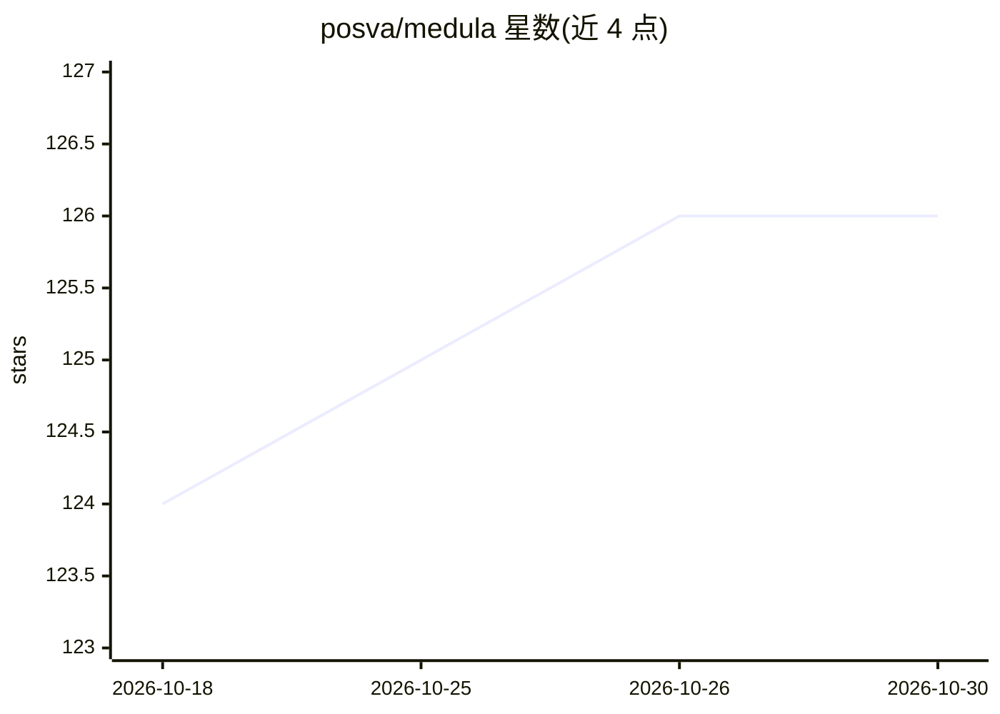

# posva/medula

⭐ 126 · TypeScript · MIT · 推送 2026-10-05 · [GitHub](https://github.com/posva/medula) · 个人维护

**让编码 agent 通过 MCP 检查和修改运行中 Web 应用状态的 devtools**

Medula 是一套 headless 开发者工具，通过 devframe hub 与 MCP 协议把编码 agent 连接到运行中的 Web 应用：agent 可检查组件树、读取并编辑组件状态、hook 状态、Pinia store、signal 等，还能控制路由导航。支持 Vue 3、React、Svelte 5、Solid，并提供 Vite、Nuxt、Next.js 集成。用于修复生产 bug 时的验证步骤或探索自动化测试难以复现的边缘情况。修改只影响运行中页面，不编辑源文件。以 npm 包安装，接入 Vite 插件或框架模块。

## 筛选速览

| 维度 | 判定 | 备注 |
|---|---|---|
| AI 角色 | `ai-ecosystem` | LLM/agent 周边工具 |
| 许可风险 | `permissive` | MIT |
| 部署形态 | `library` | 以包/库形式分发 |
| 模型依赖 | — | README 未给出锁定关系 |
| 硬件要求 | — | 无带数字的原话,不猜 |
| 安装摩擦 | `low` | 无编译、无系统依赖或容器化 |
| 成熟度 | — | 结构信号不足 |

## 能力要点

- 通过 MCP 让 agent 检查/编辑运行中应用的组件树与状态
- 支持 Vue 3/React/Svelte 5/Solid，集成 Vite/Nuxt/Next.js
- Vue 应用可操作 Pinia store 与 Vue Router 导航
- 修改只影响运行中页面，不编辑源文件

## 适用场景

- 修生产 bug 时让 agent 在真实运行的应用里验证修改效果
- 探索自动化测试难以复现的边缘情况
- 用自然语言让 agent 查看页面组件状态并做临时修改

## 场景标签

`编码 Agent` · 领域:编码与开发

## 证据(README 行号)

> L8:  Medula connects coding agents to your app through the devframe hub.
> L10: medula lets your coding agent inspect and change the internal state of a running web app through
> L11: MCP. Use it at the **verification step** when fixing production bugs or to explore edge cases that are hard to repr

## 星数曲线

2026-10-18 124 → 2026-10-30 126（+2）

---
*卡片 v1 · prompt 1.4 · 生成 2026-10-23 · 置信度 high · 依据 README sha `a5a75478602f` · [字段定义](../../DATASET.md)*
