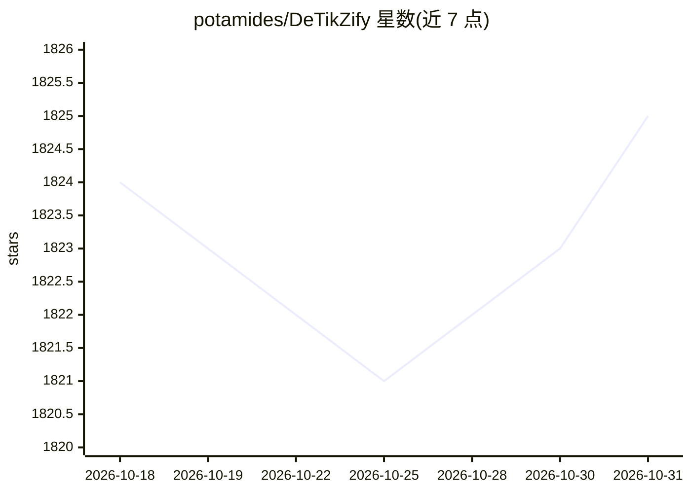

# potamides/DeTikZify

⭐ 1,825 · Python · Apache-2.0 · 推送 2026-09-17 · [GitHub](https://github.com/potamides/DeTikZify) · [官网](https://nllg-detikzify.hf.space) · 组织维护

**把草图/已有图形合成为 TikZ 程序的多模态模型**

DeTikZify 是一个多模态语言模型及相关 Python 包，根据手绘草图或已有科学图形自动生成语义保持的 TikZ 图形程序；附带基于 MCTS 的推理算法，可在不额外训练的情况下迭代修正输出。提供 v1/v2/v2.5-8b 等模型权重（托管于 Hugging Face Hub）、命令行 Web UI 与编程接口；TikZero 适配器可增加文本条件生成。运行需完整 TeX Live 2023、ghostscript 与 poppler；亦提供 Hugging Face Space 与 Colab 演示。

## 筛选速览

| 维度 | 判定 | 备注 |
|---|---|---|
| AI 角色 | `ai-native` | 本体是模型或模型工具 |
| 许可风险 | `permissive` | Apache-2.0 |
| 部署形态 | `library` | 以包/库形式分发 |
| 模型依赖 | — | README 未给出锁定关系 |
| 硬件要求 | — | 无带数字的原话,不猜 |
| 安装摩擦 | `low` | 无编译、无系统依赖或容器化 |
| 成熟度 | — | 结构信号不足 |

## 能力要点

- 从草图/已有图形合成 TikZ 图形程序
- MCTS 推理算法迭代修正输出，无需额外训练
- TikZero/TikZero+ 适配器支持文本条件生成
- 提供 Web UI、编程接口与 Hugging Face Space/Colab 演示

## 适用场景

- 把手绘草图转成可编译的科学图形 TikZ 代码
- 将非矢量格式的已有图形重建为语义化的 TikZ 程序
- 通过文本描述直接生成图形程序（TikZero）

## 场景标签

`多模态` `代码生成` · 领域:编码与开发

## 证据(README 行号)

> L11: DeTi*k*Zify, a novel multimodal
> L15: MCTS-based inference algorithm that enables DeTi*k*Zify to iteratively refine
> L138: We upload all our DeTi*k*Zify models and datasets to the [Hugging Face

## 星数曲线

2026-10-18 1,824 → 2026-10-31 1,825（+1）

---
*卡片 v1 · prompt 1.4 · 生成 2026-10-21 · 置信度 mid · 依据 README sha `30d16f1e4ba5` · [字段定义](../../DATASET.md)*
