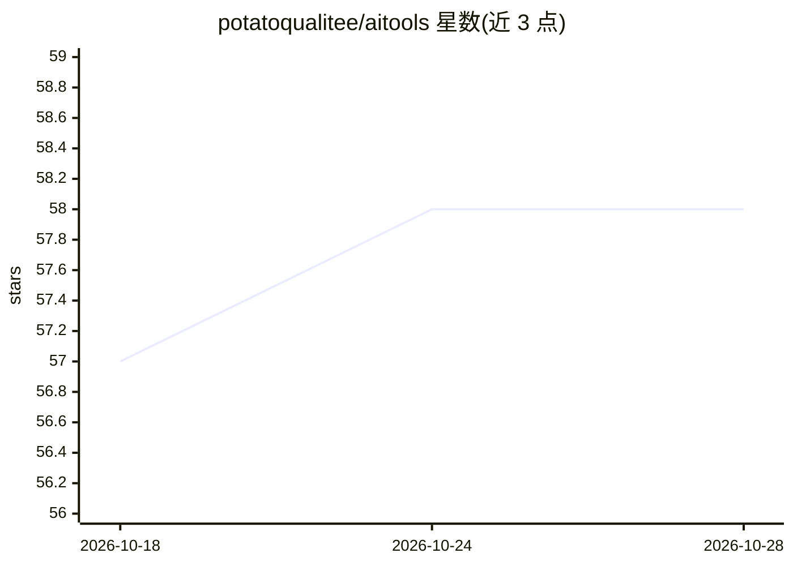

# potatoqualitee/aitools

⭐ 58 · PowerShell · MIT · 推送 2026-02-08 · [GitHub](https://github.com/potatoqualitee/aitools) · 个人维护

**用 PowerShell 批量编排 AI 编码 CLI 的包装模块**

面向使用 AI 编码助手的开发者的 PowerShell 模块：将 Claude Code、Gemini CLI、Aider、Copilot、Codex CLI、Ollama 等代理式 CLI 工具封装为统一命令接口，支持管道批量处理文件（重构、迁移、文档生成、代码风格统一），每文件独立会话以保证输出一致。机制上含工具安装与更新管理（Install-AITool，支持 CurrentUser/LocalMachine 作用域）、变更追踪供提交前审查、并行处理与重试、多工具结果对比；另集成 PSOpenAI 做图像/视频/音频生成，并提供 Pester v4→v5 迁移命令。跨 Windows/Linux/macOS，需 PowerShell 3+。

## 筛选速览

| 维度 | 判定 | 备注 |
|---|---|---|
| AI 角色 | `ai-ecosystem` | LLM/agent 周边工具 |
| 许可风险 | `permissive` | MIT |
| 部署形态 | `None` |  |
| 模型依赖 | local-ok | 支持本地模型 |
| 硬件要求 | — | 无带数字的原话,不猜 |
| 安装摩擦 | `low` | 无编译、无系统依赖或容器化 |
| 成熟度 | — | 结构信号不足 |

## 能力要点

- 统一接口包装 8 种 AI CLI 工具并支持多工具结果对比
- 管道式批量处理：每文件独立会话，含并行、重试与跳过已改文件
- Install-AITool 统一安装/更新各 AI 工具（免 sudo 的用户级安装）
- Update-PesterTest 自动迁移 Pester v4 测试到 v5 语法

## 适用场景

- 批量给成百上千个脚本加注释帮助、统一代码风格
- 把 Pester v4 测试自动迁移到 v5 语法
- 同一任务跑多个 AI 工具并对比输出
- 用 Copilot 免费档从 PDF 截图提取结构化数据写入数据库

## 场景标签

`编码 Agent` `工作流自动化` · 领域:效率与自动化

## 证据(README 行号)

> L11: aitools is a PowerShell module that wraps AI coding assistants like Claude Code, Aider, Gemini CLI, and GitHub Copi
> L34: - One consistent interface across multiple AI CLIs
> L39: Each file is processed in a fresh session, which means consistent output without conversation drift. Parallel proce

## 星数曲线

2026-10-18 57 → 2026-10-28 58（+1）

---
*卡片 v1 · prompt 1.4 · 生成 2026-10-24 · 置信度 high · 依据 README sha `a6bc8c57adfa` · [字段定义](../../DATASET.md)*
