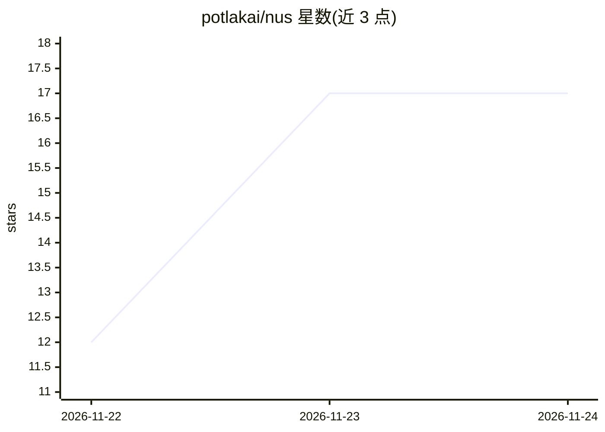

# potlakai/nus

⭐ 17 · JavaScript · MIT · 推送 2026-11-21 · [GitHub](https://github.com/potlakai/nus) · [官网](https://pdaime.github.io/nus/) · 个人维护

**给大学生的 AI 学期管家：读教学大纲安排整学期**

基于 Claude Code 构建的学期组织工具，面向学生：读取教学大纲 PDF 后生成整学期截止日期总日历、标记高压周、为每门课生成页面；提供 /due 即时查询、/brief 晨间简报、/quest 每日任务、/level 技能路线与 /capture 笔记归档等命令。数据以纯 markdown 文件保存在本机，无服务器、无数据库、无账号；使用需 Claude Code 订阅。通过 npx 或 zip 包安装，初始化约 10 分钟。

## 筛选速览

| 维度 | 判定 | 备注 |
|---|---|---|
| AI 角色 | `ai-native` | 本体是模型或模型工具 |
| 许可风险 | `permissive` | MIT |
| 部署形态 | `library` | 以包/库形式分发 |
| 模型依赖 | locked-api |  |
| 硬件要求 | — | 无带数字的原话,不猜 |
| 安装摩擦 | `low` | 无编译、无系统依赖或容器化 |
| 成熟度 | — | 结构信号不足 |

## 能力要点

- /setup 读取大纲 PDF 生成学期截止日历与每课页面
- /brief 晨间简报与 /quest 每日 3 个任务（二值完成判定）
- /level 生成 Lv1→Lv10 技能路径并融入每日任务
- 全部数据为本机 markdown 文件，无服务器与账号

## 适用场景

- 开学季导入几份大纲 PDF，让 AI 规划整学期截止日期
- 早上查看 /brief 了解今天该做什么、提前开始什么
- 把课堂笔记和想法丢给 /capture 自动整理归档
- 为想提升的技能（演讲、写作等）生成渐进练习路径

## 场景标签

`AI 助手` `知识库管理` · 领域:对话与助手

## 证据(README 行号)

> L9: *Nūs* (from the Greek *noûs*, the mind) is an AI semester organizer built on Claude Code. Every "AI assistant" demo 
> L13: - **`/setup`** learns who you are and what you're aiming for, then reads your syllabus PDFs and builds a master dea
> L22: 1. Install Claude Code (needs a Claude subscription).

## 星数曲线

2026-11-22 12 → 2026-11-24 17（+5）

---
*卡片 v1 · prompt 1.4 · 生成 2026-11-22 · 置信度 high · 依据 README sha `e289007da5ea` · [字段定义](../../DATASET.md)*
