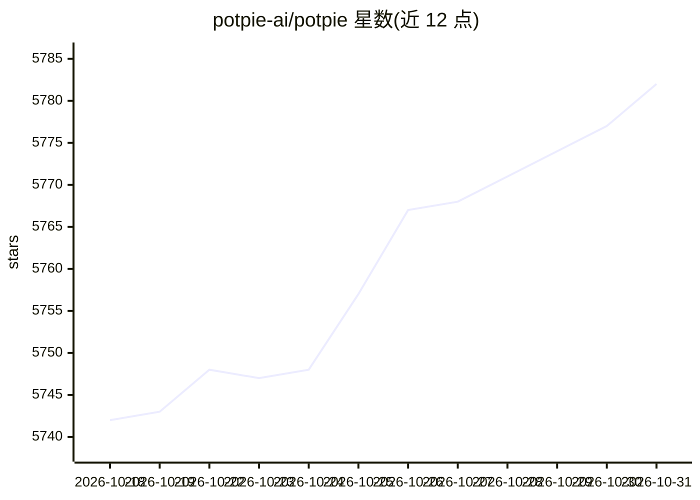

# potpie-ai/potpie

⭐ 5,782 · Python · Apache-2.0 · 推送 2026-10-30 · [GitHub](https://github.com/potpie-ai/potpie) · [官网](https://potpie.ai) · 组织维护

**把代码库与研发流程索引为 AI agent 上下文图谱的 CLI 工具**

面向开发者的 CLI 工具：将代码结构、决策、源码历史、团队知识与工程工作流索引为可被 AI agent 使用的上下文图谱，使 agent 能基于项目上下文回答问题、规划改动、调试与写代码。通过 uv/pip 从 PyPI 安装，setup 向导配置本地存储、守护进程与 agent 技能；支持 GitHub/Linear/Jira/Confluence 集成，并为 Claude Code、OpenAI Codex、Cursor、OpenCode 等编码 harness 安装技能。提供 resolve/search/record/graph 等命令与本地 Web 图谱浏览器。采用 CLI-first 架构，部分功能（potpie login）为账号托管型。

## 筛选速览

| 维度 | 判定 | 备注 |
|---|---|---|
| AI 角色 | `ai-ecosystem` | LLM/agent 周边工具 |
| 许可风险 | `permissive` | Apache-2.0 |
| 部署形态 | `library` | 以包/库形式分发 |
| 模型依赖 | — | README 未给出锁定关系 |
| 硬件要求 | — | 无带数字的原话,不猜 |
| 安装摩擦 | `low` | 无编译、无系统依赖或容器化 |
| 成熟度 | — | 结构信号不足 |

## 能力要点

- 把代码库、决策与团队知识索引为上下文图谱
- potpie resolve 按任务拉取 agent 所需上下文
- GitHub/Linear/Jira/Confluence 集成索引
- 为 Claude Code/OpenAI Codex/Cursor/OpenCode 安装技能
- 本地守护进程提供 Web 图谱浏览器

## 适用场景

- 为编码 agent 提供项目专属上下文
- 在 AI 辅助开发前按任务检索相关文件与决策记录
- 沉淀团队工程决策供 agent 查询

## 场景标签

`知识图谱` `RAG` · 领域:知识与检索

## 证据(README 行号)

> L11: Potpie turns your codebase and software development lifecycle into a living context graph for AI agents.
> L12: It indexes code, structure, decisions, source history, team knowledge and engineering workflows, so agents can answ

## 星数曲线

2026-10-18 5,742 → 2026-10-31 5,782（+40）

---
*卡片 v1 · prompt 1.4 · 生成 2026-10-20 · 置信度 high · 依据 README sha `3bdb47897e6f` · [字段定义](../../DATASET.md)*
