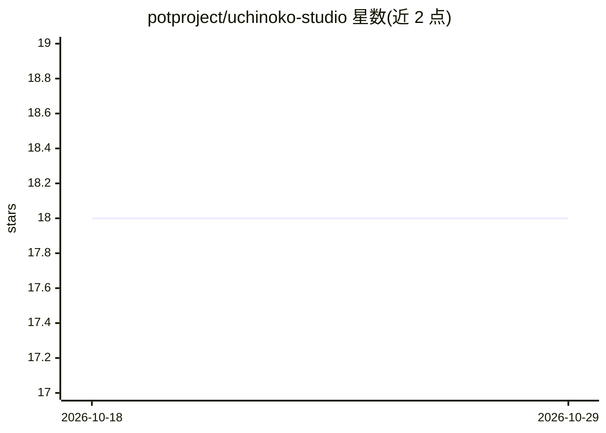

# potproject/uchinoko-studio

⭐ 18 · Go · AGPL-3.0 · 推送 2026-04-04 · [GitHub](https://github.com/potproject/uchinoko-studio) · 个人维护 · 中文 README

**与 AI 进行实时语音对话的 Web 应用，支持多角色与本地 TTS**

Uchinoko Studio 是一个用 Go 与 Node.js 构建的 Web 应用，将语音识别、对话 LLM 与语音合成串接为实时语音对话流程：STT 支持 OpenAI/Google API、Vosk Server 与浏览器 SpeechRecognition；LLM 支持 OpenAI、Anthropic、DeepSeek、Gemini 及 OpenAI 兼容端点的本地 LLM（LM Studio、Ollama）；TTS 支持 Bert-VITS2、Style-Bert-VITS2、VOICEVOX、Irodori TTS v2 等本地引擎与云端 API。本地 TTS 引擎需用户自行在本地或网络中运行并通过 .env 配置端点。仓库不含模型数据与角色图片，项目自标为 β、Work In Progress，界面目前仅支持日语。

## 筛选速览

| 维度 | 判定 | 备注 |
|---|---|---|
| AI 角色 | `ai-native` | 本体是模型或模型工具 |
| 许可风险 | `viral` | AGPL-3.0 |
| 部署形态 | `library` | 以包/库形式分发 |
| 模型依赖 | local-ok | 支持本地模型 |
| 硬件要求 | — | 无带数字的原话,不猜 |
| 安装摩擦 | `low` | 无编译、无系统依赖或容器化 |
| 成熟度 | `idea` | |

## 能力要点

- 实时语音对话，多说话人与图像支持（实验性）
- LLM 覆盖 OpenAI/Anthropic/DeepSeek/Gemini 云端与 OpenAI 兼容本地端点
- TTS 支持 Bert-VITS2/Style-Bert-VITS2/VOICEVOX/Irodori TTS v2 等本地引擎
- Tailscale 支持，可经 VPN 或 Funnel 从外部访问

## 适用场景

- 与 AI 角色进行实时语音对话
- 在浏览器或手机浏览器上与自建语音角色互动
- 搭配本地 LLM 与本地 TTS 引擎搭建不依赖云端的角色语音对话

## 场景标签

`语音 Agent` · 领域:对话与助手

## 证据(README 行号)

> L18: Uchinoko Studio is a web application designed to facilitate real-time voice conversations with AI. This is achieved
> L34: * Chat-based LLM Support: OpenAI GPT(Cloud),Anthropic Claude(Cloud),DeepSeek(Cloud),Gemini(Cloud),Local LLM(OpenAI 
> L36: * Text-To-Speech Support: Bert-Vits2(local), Irodori TTS v2(local), Style-Bert-VITS2(local), VOICEVOX(local),NijiVo

## 星数曲线

2026-10-18 18 → 2026-10-29 18（+0）

---
*卡片 v1 · prompt 1.4 · 生成 2026-10-29 · 置信度 mid · 依据 README sha `27c58e133b41` · [字段定义](../../DATASET.md)*
