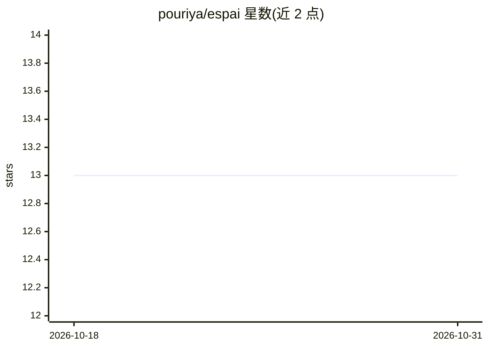

# pouriya/espai

⭐ 13 · Rust · MIT · 推送 2026-08-09 · [GitHub](https://github.com/pouriya/espai) · 个人维护

**把本机浏览器变成 HTTP 接口的本地服务，供 agent 用 curl 操控**

由原生消息宿主程序与 Chromium 扩展组成：扩展连接宿主后在 127.0.0.1 上起 HTTP 服务，随浏览器启动与退出。任何能执行 shell 命令的 agent（Claude Code、Codex、Cursor 等）可通过 curl 列出标签页、以 ref 编号快照页面、点击、输入、截图与读取网络 JSON 响应，无 SDK、无 MCP、无 API key。安全上防御了同浏览器网页的调用（X-Espai 头/Origin/Host 检查），但不做本机进程间认证，明示未对不受信任的机器加固；仅支持 Chromium 系浏览器。

## 筛选速览

| 维度 | 判定 | 备注 |
|---|---|---|
| AI 角色 | `ai-ecosystem` | LLM/agent 周边工具 |
| 许可风险 | `permissive` | MIT |
| 部署形态 | `desktop` | 安装包/桌面程序 |
| 模型依赖 | — | README 未给出锁定关系 |
| 硬件要求 | — | 无带数字的原话,不猜 |
| 安装摩擦 | `low` | 无编译、无系统依赖或容器化 |
| 成熟度 | — | 结构信号不足 |

## 能力要点

- 浏览器扩展 + 原生消息宿主，在 127.0.0.1 暴露 REST API，curl 即可驱动
- snapshot 以 ref 编号替代 CSS 选择器，ref 失效返回 410 提示重新快照
- GET / 返回完整 API 自描述文档，agent 猜错路径也能拿到接口说明
- 点击与按键经 chrome.debugger 走浏览器原生输入管道，isTrusted 为真

## 适用场景

- 让已有的编程 agent 在我登录的真实浏览器里完成调研、比价、填表等任务
- 用 shell 脚本或 cron 任务自动化操控本机浏览器页面
- 读取页面背后的原始 JSON 响应而非渲染后的 DOM 来提取数据

## 场景标签

`浏览器自动化` `网页抓取` · 领域:效率与自动化

## 证据(README 行号)

> L5: espai is a native messaging host and a Chromium extension. Together they put a running
> L9: No SDK, no client library, no language bindings, no WebDriver, no MCP server to register, no
> L40: Works with anything that can run a shell command — **Claude Code, Codex, Cursor, Gemini CLI,

## 星数曲线

2026-10-18 13 → 2026-10-31 13（+0）

---
*卡片 v1 · prompt 1.4 · 生成 2026-10-31 · 置信度 high · 依据 README sha `55004186fff2` · [字段定义](../../DATASET.md)*
