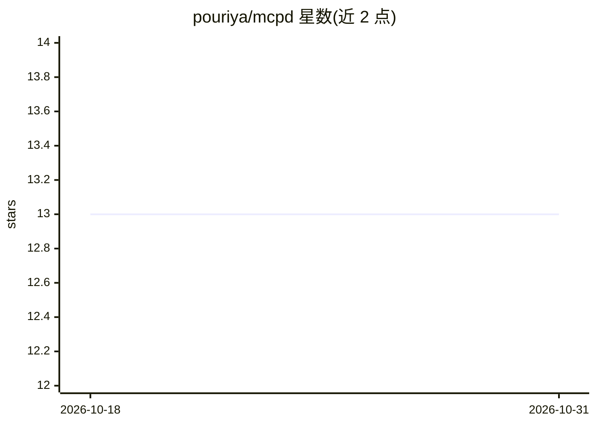

# pouriya/mcpd

⭐ 13 · Rust · BSD-3-Clause · 推送 2026-02-13 · [GitHub](https://github.com/pouriya/mcpd) · 个人维护

**将任意可执行脚本暴露为 MCP 工具的轻量守护进程**

单二进制（约 3MB）的 MCP 服务器，扫描目录中的可执行脚本，通过其 --help 输出提取元数据，自动注册为 MCP 工具与资源，供 Claude Desktop、Cursor、OpenAI Codex CLI 等 MCP 客户端调用。提供 HTTP/HTTPS JSON-RPC 传输、内置 Web 仪表盘（默认开启）、可选的用户名密码/Bearer token/CAPTCHA 认证，支持 Linux/macOS/Windows 及 Docker。脚本需为可执行文件，根目录为必填配置项。采用 BSD-3-Clause 许可。

## 筛选速览

| 维度 | 判定 | 备注 |
|---|---|---|
| AI 角色 | `ai-ecosystem` | LLM/agent 周边工具 |
| 许可风险 | `permissive` | BSD-3-Clause |
| 部署形态 | `desktop` | 安装包/桌面程序 |
| 模型依赖 | — | README 未给出锁定关系 |
| 硬件要求 | — | 无带数字的原话,不猜 |
| 安装摩擦 | `low` | 无编译、无系统依赖或容器化 |
| 成熟度 | — | 结构信号不足 |

## 能力要点

- 任意可执行脚本经 --help 元数据自动注册为 MCP 工具
- 约 3MB 单二进制，跨 Linux/macOS/Windows，支持 Docker
- HTTP/HTTPS 传输与可选认证（密码文件、Bearer token、CAPTCHA）
- 内置 Web 仪表盘用于浏览和测试工具

## 适用场景

- 把现有脚本快速接入 Claude/Cursor 等 AI 助手作为可调用工具
- 通过 Web 界面浏览与测试已注册的 MCP 工具
- 以有状态脚本（计数器、键值存储）暴露 MCP 资源

## 场景标签

 · 领域:LLM 基础设施/MCP 工具

## 证据(README 行号)

> L5: **mcpd** is an MCP (Model Context Protocol) server that turns any executable script into an MCP tool. It discovers s
> L3: MCP daemon — expose simple scripts as MCP tools and resources.

## 星数曲线

2026-10-18 13 → 2026-10-31 13（+0）

---
*卡片 v1 · prompt 1.4 · 生成 2026-10-31 · 置信度 high · 依据 README sha `405d2b536bac` · [字段定义](../../DATASET.md)*
