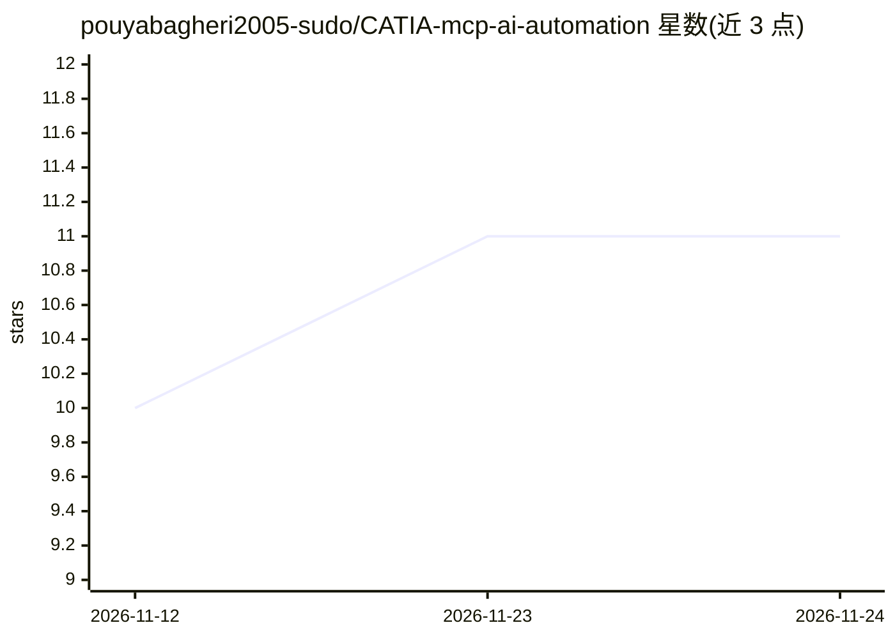

# pouyabagheri2005-sudo/CATIA-mcp-ai-automation

⭐ 12 · Python · MIT · 推送 2026-07-02 · [GitHub](https://github.com/pouyabagheri2005-sudo/CATIA-mcp-ai-automation) · [官网](https://github.com/pouyabagheri2005-sudo/CATIClaude) · 个人维护

**让工程师用自然语言驱动 CATIA V5 生成 3D 模型的 MCP 服务器**

CATIClaude 是一个连接 Claude Desktop 与 CATIA V5 的 MCP 服务器，通过 pyCATIA COM 自动化将自然语言设计意图转换为确定性 CAD 操作，生成 CATPart 文件与 STEP/IGES/STL 导出。提供文档、草图、特征、参数、分析、导出等约 25 个 MCP 工具，含草图闭合校验、COM 会话自动重连、重试与审计日志。仅支持 Windows 与 CATIA V5（R20+），部分特性可能需按版本调整。

## 筛选速览

| 维度 | 判定 | 备注 |
|---|---|---|
| AI 角色 | `ai-native` | 本体是模型或模型工具 |
| 许可风险 | `permissive` | MIT |
| 部署形态 | `desktop` | 安装包/桌面程序 |
| 模型依赖 | locked-api |  |
| 硬件要求 | — | 无带数字的原话,不猜 |
| 安装摩擦 | `low` | 无编译、无系统依赖或容器化 |
| 成熟度 | — | 结构信号不足 |

## 能力要点

- 自然语言→CAD 几何生成（design_from_text）
- 约 25 个 MCP 工具覆盖草图、特征、参数、分析与导出
- COM 会话单例管理、崩溃自动重连与几何校验
- 支持 STEP/IGES/STL 导出与参数化编辑

## 适用场景

- 用一句英文描述生成 L 形支架、轴类、壳体等机械零件
- 自动导出 STEP/IGES 文件用于后续工程流程
- 在 CATIA 中批量执行参数化修改与几何校验

## 场景标签

`代码生成` `AI 助手` · 领域:编码与开发

## 证据(README 行号)

> L11: CATIClaude is a production-grade Model Context Protocol (MCP) server that connects Claude Desktop directly to CATIA
> L13: It enables engineers to design real mechanical parts using natural language — and automatically generate:
> L120: - Natural-language CAD generation

## 星数曲线

2026-11-12 10 → 2026-11-24 11（+1）

---
*卡片 v1 · prompt 1.4 · 生成 2026-11-19 · 置信度 high · 依据 README sha `dcb7376a03b9` · [字段定义](../../DATASET.md)*
