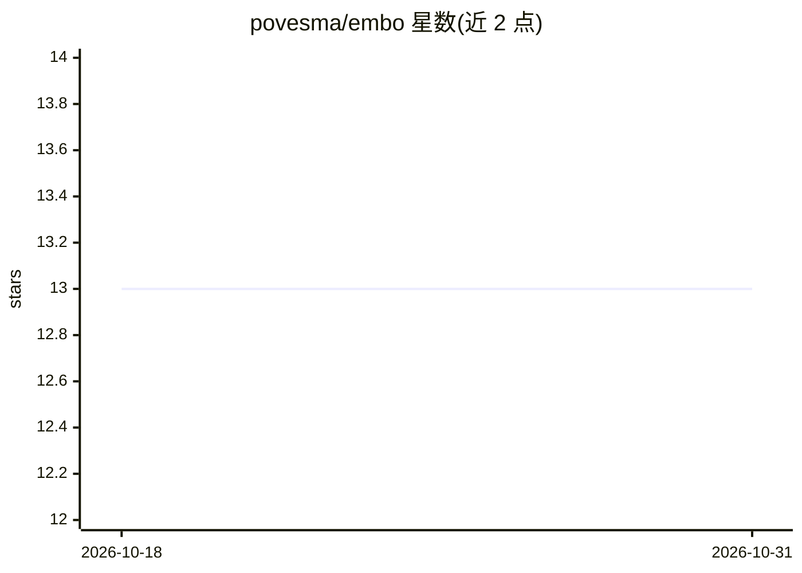

# povesma/embo

⭐ 13 · Shell · 推送 2026-10-30 · [GitHub](https://github.com/povesma/embo) · 个人维护

**面向 Claude Code 的规范驱动开发工作流插件（RLM 索引 + claude-mem 记忆）**

以 Claude Code 插件形式安装的规范驱动（spec-driven）开发工作流：/embo:prd → tech-design → tasks → impl 四阶段强制分解，配套持久化代码库索引（RLM）与跨会话记忆（claude-mem，必装的外部插件）。提供健康检查、会话上下文加载、状态行、worktree 等命令。设计原则为可重放文档树与会话幂等。依赖 Python 3.8-3.12、Node.js 20+，claude-mem 另需 bun/uv，hooks 需 jq。局限：不支持多 worktree 并行 agent，代理在单一工作树运行；Windows 安装需 PowerShell 7。

## 筛选速览

| 维度 | 判定 | 备注 |
|---|---|---|
| AI 角色 | `ai-ecosystem` | LLM/agent 周边工具 |
| 许可风险 | `none` | — |
| 部署形态 | `None` |  |
| 模型依赖 | locked-api |  |
| 硬件要求 | — | 无带数字的原话,不猜 |
| 安装摩擦 | `low` | 无编译、无系统依赖或容器化 |
| 成熟度 | — | 结构信号不足 |

## 能力要点

- 四阶段规范驱动流程（PRD→技术设计→任务分解→实现）
- 持久化代码库索引（RLM）+ 跨会话记忆（claude-mem）双上下文引擎
- 可重放文档树与会话幂等两项原则，/embo:wrapup 强制信息落盘
- 以 Claude Code 插件（/plugin install）方式安装，提供依赖一键安装脚本

## 适用场景

- 在 Claude Code 中以 PRD→设计→任务→实现的流程开发功能
- 让跨会话的历史决策与代码位置上下文自动载入规划
- 以 TDD 子任务和证据门控方式实现代码

## 场景标签

`编码 Agent` `Agent 记忆` · 领域:Agent 开发

## 证据(README 行号)

> L3: **A spec-driven Claude Code workflow** —
> L14: > - **Install:** **two plugins, inside Claude Code** — (1)
> L32: embo installs as a **Claude Code plugin**. Steps 1–3 are typed

## 星数曲线

2026-10-18 13 → 2026-10-31 13（+0）

---
*卡片 v1 · prompt 1.4 · 生成 2026-10-31 · 置信度 high · 依据 README sha `5b7665c5cfaf` · [字段定义](../../DATASET.md)*
