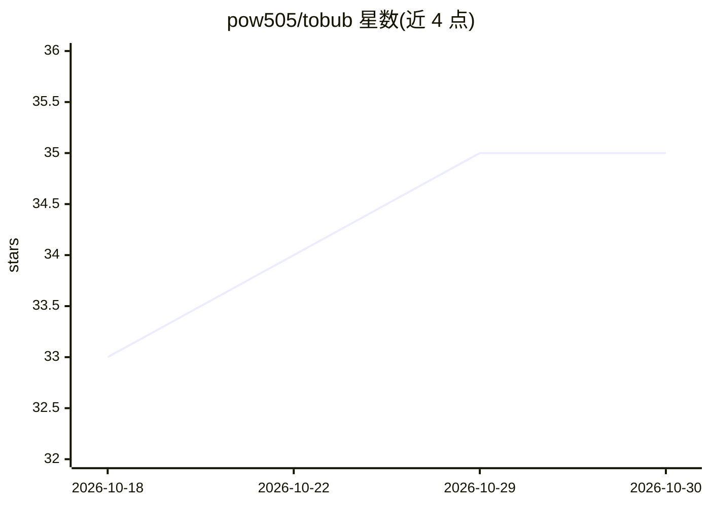

# pow505/tobub

⭐ 35 · JavaScript · MIT · 推送 2026-10-28 · [GitHub](https://github.com/pow505/tobub) · [官网](https://www.tobub.com) · 组织维护 · 中文 README

**Tobub 桌面端的开源自动化 Skill 层：AI agent 驱动本地浏览器工作流**

本仓库发布 Tobub 的开源 Skill 层：以 JSON 定义的网站自动化工作流（覆盖 Reddit、YouTube、X、LinkedIn、GitHub 等平台），以及面向 Claude Code、Codex 的 Agent Skill、DeepSeek Harness 插件和 WorkBuddy Connector 的源码。运行需另行下载的 Tobub 桌面应用与专有 Runtime；应用让 AI agent（数字员工）规划任务、调用 Skill 在本地浏览器执行，并以 Session 记录过程与结果。Skill 需配置平台账号，遵循第三方平台条款与限流。

## 筛选速览

| 维度 | 判定 | 备注 |
|---|---|---|
| AI 角色 | `ai-ecosystem` | LLM/agent 周边工具 |
| 许可风险 | `permissive` | MIT |
| 部署形态 | `None` |  |
| 模型依赖 | locked-api |  |
| 硬件要求 | — | 无带数字的原话,不猜 |
| 安装摩擦 | `low` | 无编译、无系统依赖或容器化 |
| 成熟度 | — | 结构信号不足 |

## 能力要点

- JSON 格式的可复用网站自动化 Skill 定义（研究/社媒/商业/开发者情报等 4 类平台）
- 提供 Claude Code、Codex 的 Agent Skill 与 MCP 接入指南
- 仓库内含 DeepSeek Harness 原生插件与 WorkBuddy Connector 源码
- 桌面应用与 Runtime 为专有产品、单独分发，本仓库不含执行环境

## 适用场景

- 让 AI agent 在本地浏览器批量采集 Reddit/YouTube 等平台信息
- 为 Claude Code/Codex/DeepSeek 等本地 agent 接入浏览器自动化能力
- 审阅与扩展可复用的市场情报、社媒监听工作流

## 场景标签

`浏览器自动化` `网页抓取` `工作流自动化` · 领域:效率与自动化

## 证据(README 行号)

> L18: This repository contains Skill definitions as JSON files, examples, separate Agent Skills for Claude Code and local
> L96: ## Open-source Skills for Tobub. Runtime distributed separately.
> L100: The Tobub desktop application and Runtime implementation are proprietary products distributed separately. Cloning 

## 星数曲线

2026-10-18 33 → 2026-10-30 35（+2）

---
*卡片 v1 · prompt 1.4 · 生成 2026-10-25 · 置信度 high · 依据 README sha `aa714baa2fde` · [字段定义](../../DATASET.md)*
